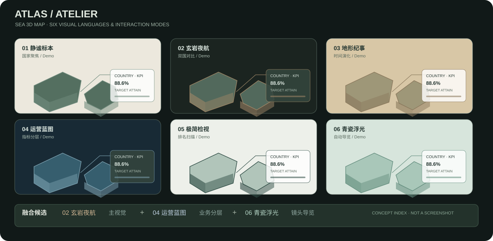

# Infograph
### Full-spectrum visual representation research & HTML gallery · 全领域可视化图形语言研究

**Infograph** consolidates reusable knowledge, design principles, chart/diagram vocabulary, interactive HTML demos and visual assets. It is **not limited to statistical charts**: industrial exploded views, engineering drawings, flow/systems modeling, geospatial views and scientific imagery all belong to its intended research scope.

> **Current maturity: research baseline / 研究性资源库。** 24 families and 630 named catalog entries are searchable, but domain breadth remains **incomplete** and only 185 entries have direct name evidence from consulted source directories. This is not a 630-component rendering library.

## V1.3.0 engineering candidate / 工程候选版

The Master Skill now combines narrative, color, typography, composition, material, motion and representation guidance with a shared design engine and seven interactive Studios. This is an internal candidate, not an accepted release.

- Three discoverable skills: [infograph-master](skills/infograph-master/SKILL.md), [narrative-design](skills/narrative-design/SKILL.md), [visual-metaphor-intelligence](skills/visual-metaphor-intelligence/SKILL.md). [Registry](skills/manifest.json) and [portable installation guide](docs/PORTABLE-SKILL.md).
- [V1.3.0 candidate changelog and verification limits](docs/consolidation/V1.3-RELEASE-NOTES.md).
- [Release evidence and limitations](docs/consolidation/V1.2-RELEASE-NOTES.md).
- [Benchmark protocol](skills/infograph-master/benchmark/PROTOCOL.md): 24 pilot runs planned, zero real model runs evidenced.
- [Formal release gates](docs/consolidation/release-gates.json): same-revision acceptance remains pending.

## Browse / 快速入口

| Section | What is inside |
|---|---|
| **[Interactive preview / 交互作品展厅](index.html)** | One-page, offline-first gallery of 15 HTML experiments |
| **[Professional types / 专业图型增量](catalog/extensions/index.html)** | Search 155 professional candidates across 18 disciplines (134 new exact-name candidates) |
| **[107-domain coverage map / 学科覆盖地图](docs/research/open-domain-coverage-map.md)** | 10 domain clusters; 18 seeded, 12 baseline-partial, 77 still unaudited |
| **[Agent Skills / Skills与引擎](docs/engineering/agent-skills-and-renderers.md)** | 20 researched Skill links, maturity caveats, and renderer selection |
| **[Domain → Skill / 领域对应技能](docs/engineering/domain-to-skill-routing.md)** | 18 domains, transferable skills and specialist gaps |
| **[Visual Atlas / 全领域图型目录](catalog/README.md)** | [Searchable HTML](catalog/visual_representation_atlas.html), [630-item JSON](catalog/visual_representation_atlas.json), Excel-friendly CSV exports |
| **[Design & research / 方法论](docs/INDEX.md)** | Five dimensions, visual grammar, domain coverage, use cases, design experiments |
| **[HTML examples / 可运行原型](examples/README.md)** | 15 standalone HTML files: dashboards, 3D maps, variants, interactive storytelling |
| **[Six Golden Types / 六个跨领域图型](examples/golden-six/index.html)** | Offline SVG views: exploded, circuit, geology, H–R, ATT&CK matrix, train timetable; semantic CI |
| **[SVG & PNG assets / 视觉素材](assets/README.md)** | 8 SVG diagrams and 4 PNG style studies |
| **[Migration & provenance](MIGRATION_MANIFEST.md)** | Original source mapping, exact-copy evidence, adaptation rules, excluded sensitive assets |
| **[Integrity & QA audit](QUALITY_AUDIT.md)** | 27/27 byte-matched assets, Markdown path checks and outstanding verification gates |



## Core design workflow

```text
Audience + Information Intent + Domain
         ↓
Objects / Relationships / Tasks / Evidence
         ↓
Basic visual encoding + domain-specific representation
         ↓
Layout / Material / Color / Projection / Interaction
         ↓
SVG | Canvas | D3 | ECharts | WebGL | Three.js
         ↓
Semantic QA + Visual QA + Interaction QA + Evidence audit
```

**Important distinction:** exploded view is a structural representation, isometric projection is a camera/projection convention, glass material is a rendering choice, and expand/explode animation is an interaction mode. They can be combined, but should not be counted as four independent chart types.

## Golden Six progress

Six source-backed, dependency-free SVG prototype renderers are now available in [Golden Six](examples/golden-six/README.md). This phase advances professional **definitions, minimal semantic constraints, interactions and executable smoke checks**. The [Chromium CI acceptance run #45040682399](https://github.com/XiangLuoyang/Infograph/actions/runs/45040682399) passed on the final renderer revision. It **does not** establish industry-standard compliance or human-expert visual approval. See the [evidence dossier](docs/research/golden-six-evidence.md) and [API](docs/engineering/golden-six-api.md).

## Current inventory

- **17** adapted research and methodology documents
- **15** byte-identical migrated HTML demos plus **2** new directory viewers (`index.html`, `catalog/extensions/index.html`)
- **8** byte-identical SVG diagrams
- **4** byte-identical PNG style studies
- **630** named V0.1 baseline entries across **24** provisional families; **155** second-round discipline seeds across 18 domains (**134** do not exact-match the baseline; **not** 134 verified independent new graph grammars)
- **20** linked Agent Skills with maturity/use-case notes and a proposed HTML visual-routing contract
- **107** registered research domains in 10 clusters; 18 seeded, 12 legacy-partial, and 77 not yet audited
- **1** brand-specific original HTML intentionally withheld from this public repo pending content review

## Quality / publication boundaries

- No false completeness claims: see [initial breadth audit](docs/research/full-spectrum-breadth-audit.md) and [second-round domain expansion](docs/research/cross-domain-expansion-2026-11-22.md).
- All dashboard metrics and operating examples are illustrative/synthetic; *do not infer actual company performance*.
- 3D renderers may use approximate geometry, procedural textures, or simplified territory shapes rather than real DEM/satellite assets.
- Demos may be exploratory and have **not been individually browser-regression-tested after migration**.
- Source Nebula knowledge base is private and was **not modified or deleted** during this extraction.
- No third-party installed Skills are bundled without license review. This repo currently does **not specify a license**; confirm rights before further reuse/distribution.

## Next steps

Complete missing discipline coverage → normalize canonical graph types vs. variants/modifiers → add authoritative examples and verification levels → create portable reusable HTML components → run browser QA and maintain a tested gallery.

Created from a curated extraction on **2026-11-22**; cross-domain research and skills shortlist expanded on the same date.
