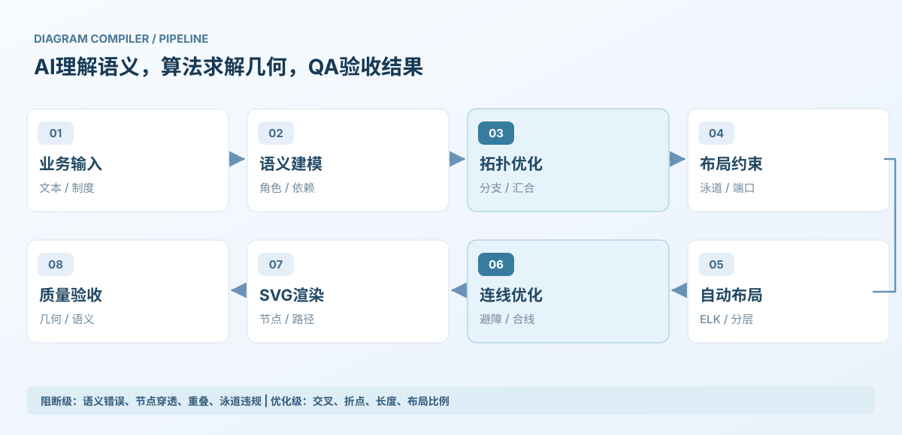
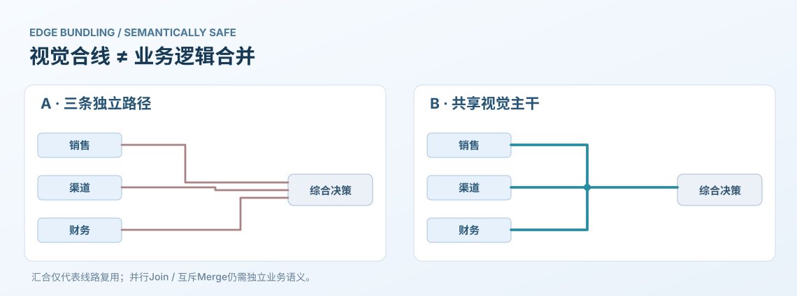

> **Public research extract · 2026-11-22.** Examples are synthetic/conceptual. Internal Obsidian links not present in this selection have been flattened.

---
title: ProcessIR流程图编译与连线验收Playbook
created: 2026-11-07
updated: 2026-11-07
type: tool
status: active
narrative: analytical
schema_version: 4
tags: [ProcessIR, ELK, SVG, ReactFlow, 泳道, 布线, 验收, 自动布局]
summary: 通过语义中间表示、规则/拓扑优化、ELK布局、路径规划、SVG渲染和几何/语义校验，解决AI直接生成HTML流程图时杂线、重叠、穿透、误合并等问题。
---

# 🛠️ ProcessIR 流程图编译器：从语言到可验证的连线

> [!abstract]
> AI负责理解业务，ProcessIR保留语义，ELK等算法负责自动布局，路由器负责正交避障与共享线段，Validator负责验收。**Skill是编排者而不是布局算法本身。** 本页是设计/实现建议，非已开发的可运行引擎。

## 一、八步固定工作流

| 阶段 | 输入 → 输出 | 责任 |
|:---|:---|:---|
| 01 业务输入 | 需求、制度、角色 → 约束清单 | User/AI |
| 02 语义建模 | 流程动作、条件、依赖 → ProcessIR | LLM+Schema |
| 03 拓扑优化 | 去冗余、识别分支/汇合 → 语义等价图 | Rule Engine |
| 04 布局约束 | 泳道顺序、阶段、端口、间距 → LayoutSpec | Constraint |
| 05 自动布局 | 分层、节点顺序、交叉优化 → 几何结果 | ELK Layered |
| 06 连接路由 | 正交走线、避障、合线、外围回路 → Paths | Router |
| 07 渲染 | 节点、连线、标签 → SVG/HTML | Renderer |
| 08 质量验收 | 几何、语义、浏览器截图 → Validation | QA |

## 二、流程中间格式：源数据，而不是HTML坐标

~~~json
{
  "meta": {"id": "synthetic-channel-case", "direction": "RIGHT"},
  "lanes": ["销售", "渠道", "财务", "BU"],
  "nodes": [
    {"id": "A", "type": "task", "lane": "销售", "label": "需求提报"},
    {"id": "B", "type": "task", "lane": "渠道", "label": "准入检查"},
    {"id": "C", "type": "task", "lane": "财务", "label": "资金测算"},
    {"id": "D", "type": "task", "lane": "BU", "label": "方案决策"}
  ],
  "edges": [
    {"id":"e1","source":"A","target":"B"},
    {"id":"e2","source":"A","target":"C"},
    {"id":"e3","source":"B","target":"D"},
    {"id":"e4","source":"C","target":"D"}
  ],
  "constraints": {
    "fixedLaneOrder":true,
    "orthogonal":true,
    "allowVisualBundling":true
  }
}
~~~

> [!caution] 示例模型不代表可执行BPMN
> 上例用来说明输入结构，没有为A发起并行任务的情况添加明确分叉/汇合网关。正式业务建模必须显式表达并行/互斥、网关、条件边、消息边、回退语义和审计属性；**不能仅靠画在一起的线暗示同步**。不可依据这份极简IR生成合规审批程序。

## 三、拓扑合并 ≠ 视觉合线

- **拓扑合并**会改变节点、网关或依赖，必须经过语义等价验证。
- **视觉合线**将独立edge的路由共享某条走线通道，必须保留每条edge的唯一标识和来源/目标。
- 同源向多目标可以先共用出口主干；多源汇入同一节点可以共用末端通道；但并行Join和条件Merge必须用可区分的网关语义。
- 异常回退走外围，避免穿透主轴；跨泳道交接优先使用预留通道和端口。

## 四、布局及路由技术栈

参考配置（需按实际ELK版本检查）：

~~~javascript
const layoutOptions = {
  "elk.algorithm": "layered",
  "elk.direction": "RIGHT",
  "elk.edgeRouting": "ORTHOGONAL",
  "elk.layered.mergeEdges": "true",
  "elk.spacing.nodeNode": "30",
  "elk.layered.spacing.nodeNodeBetweenLayers": "70"
};
~~~

ELK Layered承担节点分层/排序/交叉优化/基础正交路由；mergeEdges不等于完整的业务语义合并，也不能保证自动满足固定泳道与任意视觉总线要求。复杂部门泳道需要端口/分组/层次约束与二次路由。

推荐工具：ELK.js（布局）、自定义Bus Router（线段/通道合并）、SVG（静态产出）、React Flow（交互编辑可选）、Playwright（截图与可视化验收）。如必须符合BPMN，使用bpmn-js或对应模型校验。

参考：
- [ELK](https://eclipse.dev/elk/)
- [elkjs](https://github.com/kieler/elkjs)
- [React Flow Examples](https://reactflow.dev/examples)
- [bpmn-js](https://bpmn.io/toolkit/bpmn-js/)

## 五、质量门禁（硬约束先于软评分）

**硬约束：必须全部满足**——语义不变、角色不串、条件及网关正确、无节点重叠、无无关线穿透节点、无标签遮挡、固定泳道不乱、文字可读、路径终点正确。

**软评分：择优**——交叉次数、折点数量、总线长、回退绕行、画布尺寸、画面平衡。建议尝试3–5组布局候选，先淘汰硬约束不合格者，再选软分最低者。不存在对所有图型一劳永逸的“绝对零交叉”。

**检验回路**：校验IR → 生成布局 → 校验几何 → 浏览器实际渲染截图 → 失败先调整端口/排序/线路，再必要时回到拓扑层；禁止直接让LLM反复盲改坐标。

## 六、最小交付包和迭代

~~~text
process.json      # 语义与来源的唯一可信记录
layout.json       # 节点坐标、端口、线段与ID映射
diagram.svg       # 审核后的矢量资产
validation.json   # 硬门禁、软评分与问题
preview.html      # 可选交互预览
~~~

- V1：普通流程图自动布局与SVG输出。
- V2：固定泳道、跨部门交接通道、bus合线、异常外侧回路。
- V3：指标、责任、超期和闭环状态叠加到流程，看板可钻取。
- 当前Nebula中本次SVG是**用于阅读的概念原型**，不是上述引擎生成的真实验收产物。正式可编辑图件仍按 [工具-drawio-workflow](drawio-workflow.md) 的YAML-first规范维护。

## 相关
- [综合-企业经营看板与流程可视化研究地图](../research/research-map.md)
- [概念-流程图泳道图的视觉表达与复杂性边界](../foundations/flowchart-swimlane-grammar.md)
- 概念-2.5D业务治理空间地图
- [工具-企业经营治理HTML看板生成与验收](html-dashboard-generation-qa.md)
- [工具-drawio-workflow](drawio-workflow.md)
