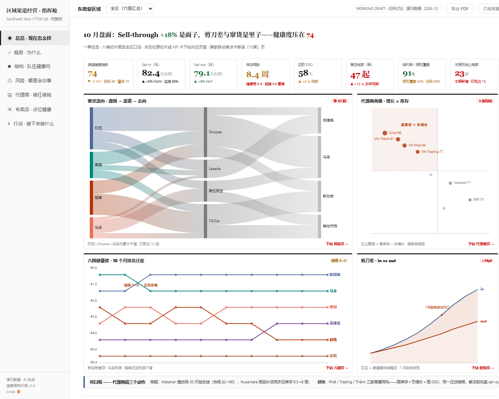
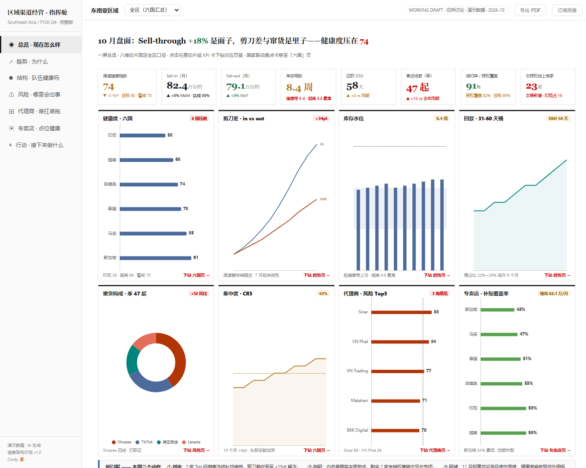
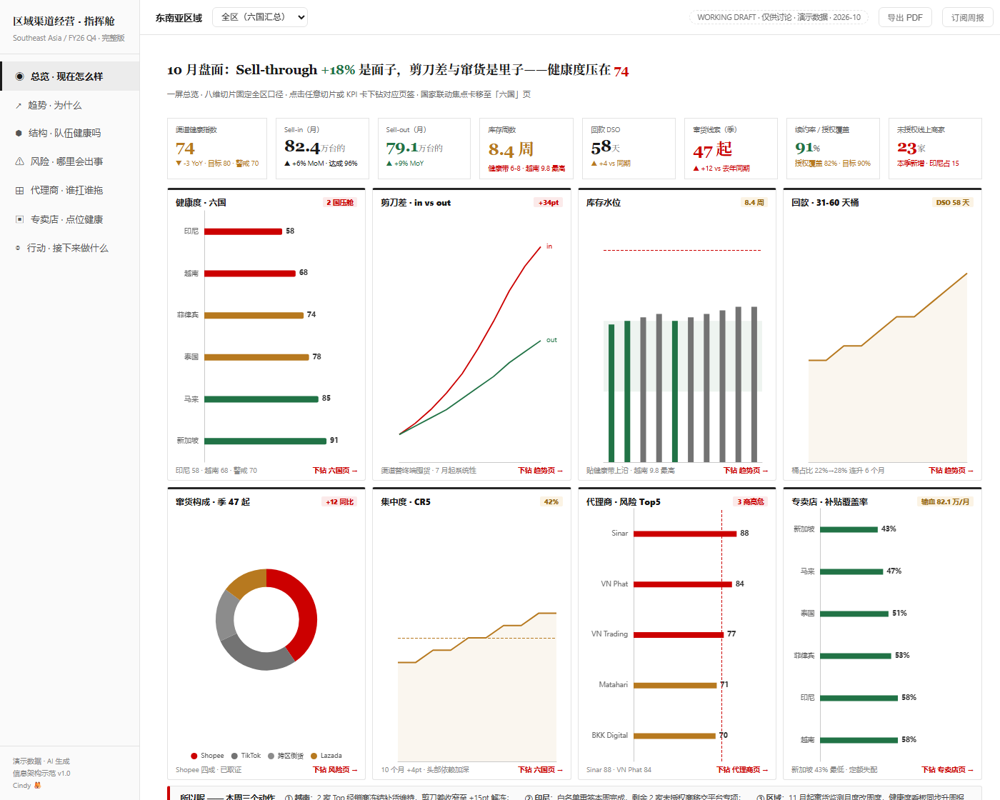
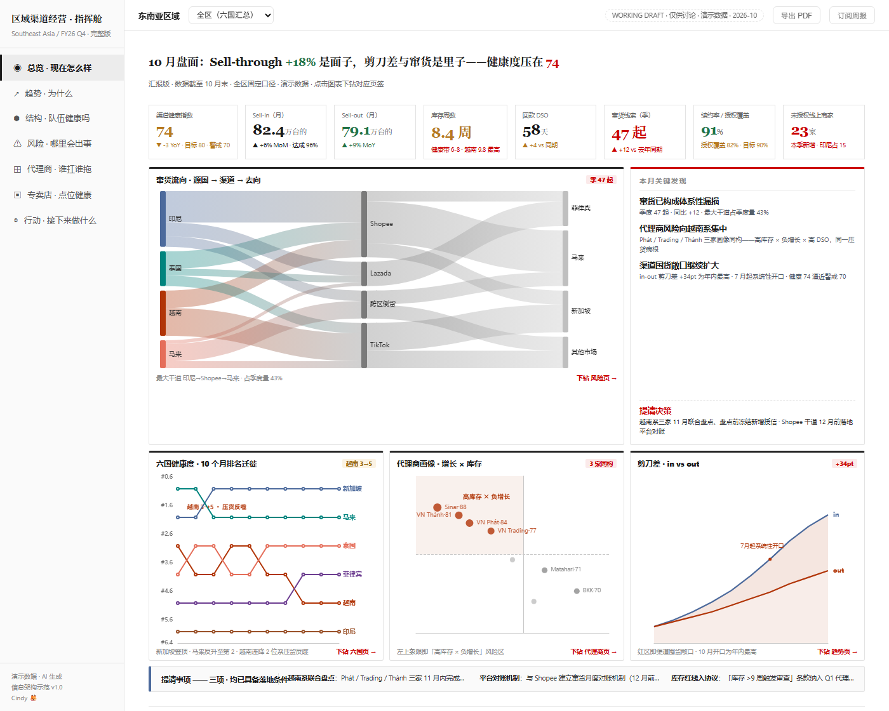

> **Public research extract · 2026-11-22.** Examples are synthetic/conceptual. Internal Obsidian links not present in this selection have been flattened.

---
title: 看板风格演进与汇报版式：从反 AI Slop 到汇报级配方
created: 2026-11-03
updated: 2026-11-03
type: concept
status: active
narrative: analytical
summary: 2026-10-31~11-02 以东南亚渠道经营看板为载体的三轮风格实战迭代——Bain 风格重构、P1 封面杂志化（高级图表选型）、A 版汇报版式——沉淀出可复用的「汇报版配方」：结论标题、KPI 证据行、主视觉+关键发现栏、图注解读句、提请事项三要素。承接 [概念-AI数据看板设计美学-反AI-Slop](anti-ai-slop.md)。
tags: [AI, 数据可视化, dashboard, 设计, 汇报, 版式, 数据叙事, IBCS, OWID, 2026]
schema_version: 4
---

> [!abstract]
> 6 月的反 AI-Slop 研究（[概念-AI数据看板设计美学-反AI-Slop](anti-ai-slop.md)）回答的是「AI 生成看板为什么同质化」；本文是它的实战续篇，回答「风格定了之后，版式怎么服务场景」。以东南亚渠道经营看板为载体完成三轮迭代，核心结论：**态势感知看板和汇报材料是两个物种——汇报材料里图表只是证据，论证才是主角。**

# 看板风格演进与汇报版式

## 一、风格示范（Exemplar）调研

开工前收集的样图与框架（样图存 workspace `research/exemplars-img/`）：

- **OWID ×4**（child-mortality / co-emissions / extreme-poverty / life-expectancy）：叙事式排版范本——衬线大标题、白底、直角分栏、脚注带来源与口径、一张图只讲一件事
- **ZebraBI templates**：商务看板的行级对齐、「指标卡+趋势」紧凑组合
- **FT Visual Vocabulary**：图表选型按数据关系分类（偏离/排名/分布/联系…），先定关系再定图型
- **datylon 图表型录**（80 型）：选型清单，防止「默认柱线图惯性」
- **IBCS SUCCESS**：语义规则——好=绿/坏=红、细节左聚合右；实际使用时做了裁剪
- **PMC 科研制图原则**：无装饰、字体层级、单位与来源必须标注

> [!warning] 教训
> 样图收集后**必须进入决策**。本轮前半程 exemplar 一直躺在文件夹里没进任何设计决策，直到被批评「风格与前期调研无关」才回补对照——调研不进决策等于没调研。

## 二、三轮迭代

### 迭代一：Bain 风格重构（10-31）

第一轮全面换肤：直角卡片替代圆角、克制用色、Source line 标来源口径、Executive Summary 页思路。解决「AI 味」，但页面信息架构未动。

### 迭代二：P1 封面杂志化（11-01）

批评驱动：「图表太多、都是初级图表、跟应届生做的一样、要科研制图素材。」

- **版式**：8 等分栅格 → 2 行不对称（约 1.9:1），首行给主视觉让位
- **图表**：8 张砍到 4 张高级图——
  - 窜货流向 Sankey（源国→渠道→去向三层，节点同名冲突用零宽字符前缀解决）
  - 代理商四象限散点（markArea 风险区 + 十字参考线 + 逐点 graphic 标注）
  - 六国排名 Bump（inverse yAxis + endLabel 线尾国名）
  - 剪刀差增强（in/out 双线 + 差值填充带 + 拐点 markPoint）
- **原则**：降级不删数——库存、CR5 等被砍的指标降为 KPI 数字块，数据仍在页面



### 迭代三：A 版汇报版式（11-02）

场景纠正：应用场景是**公司内部汇报材料**，不是实时态势感知。看板因此分两物种——

- 态势感知：看的人天天看，图表自己会说话，密度优先
- 汇报材料：看的人只看一次，**图表只是证据，论证才是主角**，洞察文字与图表并置

同轮做了双样张对照定风格基调：

- **C 方案**：IBCS 语义骨架 + OWID 排版层（语义红绿、衬线标题、白侧栏、直角卡、虚线网格、脚注）
- **B 方案**：OWID 叙事纯色板（蓝 #4c6a9c / 橙红 #b13507 / 青绿 #00847e / 橙 #e56e5a / 绿 #58a14e），弃语义红绿改叙事用色
- **拍板**：B 立住，后续汇报版基于 B 迭代





在 B 之上完成 A 版（对上汇报版）：



## 三、汇报版配方（可复用）

| 要素 | 做法 | 为什么 |
|---|---|---|
| 结论标题（action title） | 标题即判断：「+18% 是面子，剪刀差与窜货是里子——健康度压在 74」 | 只看一次的人结论先行 |
| KPI 证据行 | 指标卡含同比/达成/警戒线，一行 8 卡 | 证据摘要，支撑标题判断 |
| 主视觉 + 关键发现栏 | 主图占 2/3；右栏 3 条发现每条带数字证据，底部红字「提请决策」 | 图表与论证并置，眼动不打断 |
| 图注 = 解读句 | 脚注写「意味着什么」，不复述图名 | 替看的人完成第一次解读 |
| 提请事项 | 三项并列，每项 = 主体 + 动作 + 时限 | 汇报落点不是「情况」而是「动作」 |
| 演示数据纪律 | 所有数字取自页面既有演示数据，不编新数 | 换真数时口径一致 |

版式骨架：

```
结论式标题
KPI 行（证据摘要）
┌────────────────────┬───────────┐
│ 主视觉 2/3          │ 关键发现栏 │
└────────────────────┴───────────┘
三图横排（各带一句解读脚注）
提请事项（三项并列）
```

## 四、遗留与下一步

- CR5 集中度仍琥珀色（C/B 两版相同），全量铺七页时统一
- 演示数据待换真数：窜货流向矩阵、象限坐标、排名序列、P7 单店演示账
- B 版（对外交流）版式待做，口吻可比对上版更锋利
- 工程侧教训（headless 渲染管线取证、PowerShell GBK 坑、CDP 调试法）属工程而非知识，留 workspace memory 日志，不入库

---

## 延伸阅读

- 前篇：[概念-AI数据看板设计美学-反AI-Slop](anti-ai-slop.md)（2026-06，社区反 Slop 四方向调研）

(2026.11.03 创建)