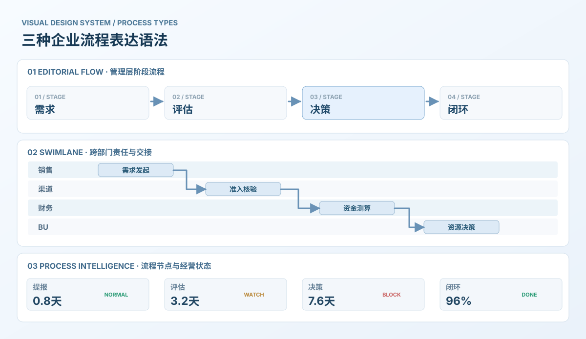

> **Public research extract · 2026-11-22.** Examples are synthetic/conceptual. Internal Obsidian links not present in this selection have been flattened.

---
title: 流程图与泳道图的视觉表达及复杂性边界
created: 2026-11-07
updated: 2026-11-07
type: concept
status: active
narrative: analytical
schema_version: 4
tags: [流程图, 泳道图, BPMN, ServiceBlueprint, 信息设计, 复杂性, 治理]
summary: 区分流程建模、流程表达与流程运营，并比较六种适合企业经营治理的表达方式，解释为什么靠节点美化难以获得高阶差异化。
---

# 🧭 流程图与泳道图：把结构画清楚，而不是画复杂

> [!abstract]
> **流程图的视觉天花板受拓扑语义约束。** 区别于一般图片设计，节点代表动作、线条代表关系，不能为了审美随意变更。关键竞争力是复杂业务的可理解性、权责清晰和流程与经营决策的融合。

## 一、三个不同的问题

**Process Modeling（语义）**：谁做什么；分支是否互斥；哪些并行；哪些动作/审批必须先完成。

**Process Visualization（表达）**：节点形状、线条、留白、视觉主轴、分层、泳道和标签。

**Process Intelligence（运营）**：SLA、周期、库存/资金指标、积压、异常、责任人和闭环状态。

三层不能混写：画得漂亮不等于业务正确；业务正确不等于高级经营看板。

## 二、六类表现形式及选择依据

| 表达 | 适用信息 | 最佳场景 |
|:---|:---|:---|
| 叙事型阶段流程 | 核心业务阶段和关键决策 | 高管汇报 |
| 现代卡片泳道 | 部门责任、交付、控制点 | 跨部门治理 |
| BPMN决策流程 | 条件、事件、网关、消息 | 制度、审批、系统流程 |
| Service Blueprint | 前台、后台、支持流程层 | 门店/代理商服务旅程 |
| 运营监控型流程 | 工作状态、处理耗时、积压 | 经营驾驶舱 |
| Sankey数量流 | 流量、转化、资金/库存数量 | 渠道流向与量级分析 |

业务问题若是责任分配，也可能优先用RACI；若是时间推进可用时间线；若是多方关联可用网络图。

## 三、为什么只是美化方框很难打出差异

1. 为了不误导，图必须遵守方向、先后、并行、互斥等语义。
2. 节点多、分支多会让连线占据视觉空间；高级阴影/玻璃效果反而增加噪音。
3. 不同设计体系最终容易收敛为类似的矩形、分隔和连接线。
4. 优秀流程图首先降低认知负担，不以“设计存在感”作为指标。

**要素编码建议**：水平表示阶段、纵向表示角色、颜色表示风险/状态、节点形状表示任务/判断/事件、连线表达顺序与交接；交接线上标注交付物与时限。不同部门不必使用大面积彩底。

## 四、治理表达的三层视图

- **L1 Executive**：少量关键阶段、结论、需要谁拍板。
- **L2 Governance**：部门泳道、权责边界、KCP、决策权/否决权、交接点。
- **L3 Operational**：详细步骤、SLA、异常、返工、审计记录。

同一套可信ProcessIR导出不同阅读视图，胜过对三层分别生成互相冲突的HTML图。

## 五、最高优先的线路规则

主流程尽量保留一条视觉主轴；异常/回退走外侧；跨泳道走预留通道；可共享的独立逻辑边允许共享视觉主干；合线前明确同步/条件语义。详见 [工具-ProcessIR流程图编译与连线验收](../engineering/process-ir-layout-routing.md)。

> [!question] 尚待验证
> 更好的视觉设计是否真的让高管更快识别业务问题？二维/2.5D哪一种对同一业务条件的识别错误率更低？需要受众任务测试，不凭审美偏好断定。

## 相关
- [综合-企业经营看板与流程可视化研究地图](../research/research-map.md)
- [工具-ProcessIR流程图编译与连线验收](../engineering/process-ir-layout-routing.md)
- 概念-2.5D业务治理空间地图
- [工具-drawio-workflow](../engineering/drawio-workflow.md)
- 概念-企业运营治理框架-治理对象-治理域-决策权
