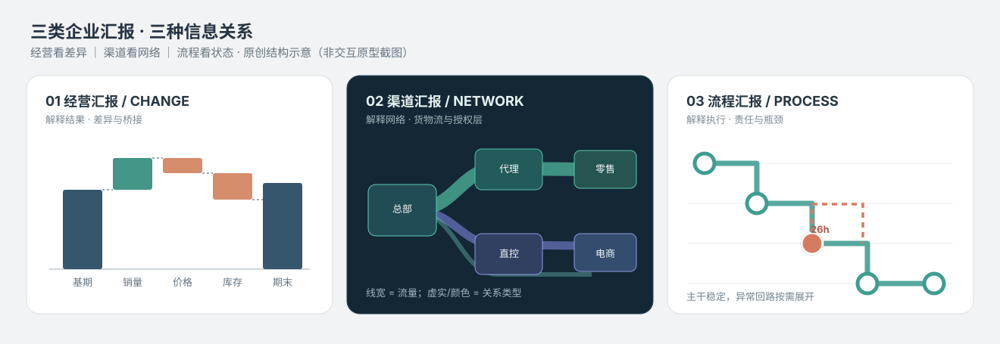

> **Public research extract · 2026-11-22.** All business metrics in referenced demos are illustrative. Links to non-migrated private Obsidian pages are plain text.

---
title: 业务经营、渠道结构与流程治理——三类汇报看板的可视化范式
created: 2026-11-07
updated: 2026-11-08
type: synthesis
status: active
narrative: analytical
schema_version: 4
tags:
  - 企业经营
  - 渠道管理
  - HTML看板
  - 数据叙事
  - 关系网络
  - 流程治理
  - 交互设计
  - DashboardOS
  - Weft
summary: 将业务经营汇报、渠道结构汇报和流程治理汇报拆分为三套视觉语言及交互契约；归档可切换HTML原型，提出统一业务对象模型、双层汇报架构及验收标准。
as_of: 2026-11-07
confidence: medium
evidence_level: mixed
---

# 业务经营、渠道结构与流程治理：三种可视化世界

> [!abstract]
> **不应将三类汇报理解为“同一个看板换三套配色”。** 业务经营研究**结果与差异**，渠道结构研究**主体、流向与控制关系**，流程治理研究**动作、责任和运行状态**。选择正确的信息关系，比3D效果、光影和卡片材质更重要。真正的高质量看板，使管理者先理解发生了什么、为什么值得关心、谁需作何决策，再按需钻取证据。

> [!info] 证据与素材边界
> 来源：2026-11-07 对话中的三场景可视化讨论与同日制作的原型。**已实现（原型层）**：单HTML切换三个场景、经营国家交互、渠道货物流/权责关系切换、渠道节点点击、流程节点点击。**未实现或未验证**：真实企业数据连接、可验证的经营因果模型、实际3D地图整合、在线监控、生产级流程挖掘。HTML全部使用**虚构演示数据**，不可当作公司或国家真实经营指标。视觉索引是原创SVG结构示意，不是浏览器截图。

> [!important] 2026-11-08 需求升级
> 后续明确：三场景原型仅验证可视化语法和视图切换，**不满足用户想要的跨模块业务机制联动与模拟**。最新定位与P0–P3验收顺序见 [综合-渠道经营机制沙盘与跨模块推演设计](channel-business-mechanism-workbench.md)；本文继续作为图形选择与基础交互对照，不应被视为经营推演引擎的实现记录。

## 一、汇报问题决定图形语法

| 场景 | 核心问题 | 数据的主关系 | 首选可视化 | 容易混淆的点 |
|:---|:---|:---|:---|:---|
| **业务经营** | 为什么发生变化？差距在哪里？ | 变化、偏差、比较、拆解 | 经营桥接/瀑布图、Small Multiples、WOS/利润热力图、指标树 | 算术拆解≠因果证明；指标改善≠经营质量必然改善 |
| **渠道结构** | 货、钱、权利和责任在谁手里？ | 主体、层级、流量、依赖、网络 | Sankey/Alluvial、节点链路、树图、地理网络、2.5D/3D层叠视图 | 货量占比≠控制权；未经核对不能让线条暗示真实归属 |
| **流程治理** | 事情如何运行，卡在哪里，谁负责解决？ | 顺序、状态、角色、交接、耗时 | 地铁线式主干、泳道、事件时间轴、瓶颈热力图、异常回路 | 绘制理想流程≠还原实际日志；步骤完成≠治理闭环 |

**场景的二重架构**：
- **汇报型（Executive Brief）**：一屏结论→主证据→决策请求；关键结论不依赖点击，适合30秒到3分钟。
- **探索型（Analytical Workbench）**：从同一对象/口径进一步筛选、查看明细、比较假设和追溯事件；供Owner或分析师深挖。
- 两种使用场景共用证据模型，不能把“交互丰富”误解为“汇报效率高”。

## 二、业务经营：经营桥接而非KPI拼贴

### 推荐画面
1. **一句话结论式标题**：例如“规模增长，但动销与库存周转出现分化”（须有数据支持）。
2. **结果证据层**：营收/利润/动销/库存周转，明确期间、基准、单位、变化值。
3. **主图**：以瀑布图拆解起点和终点的算术变化；以市场条形图和异常热力图显示差异。
4. **管理动作**：变化的优先核验事项、责任人、复核时点、期望决策。
5. **点击市场**：切换局部解释，继续查看国家→渠道→客户→SKU，而不是在首屏堆所有信息。

### 原型的具体实现
- 经营桥接数字：基期100 → 销量+18 → 价格-5 → 库存/退货-8 → 结构+3 → 期末108，**仅为数学构造的示意分解**。
- 市场选择：泰国、越南、马来西亚、香港；示例WOS和动销均为虚构。
- 风格：明亮米白、财经编辑式版面、强调色克制、结论与解释并列。
- **下一阶段可做**：经营沙盘/敏感度分析，交互调节铺货、价格、毛利等假设；前提是有明确公式、约束、参数来源和反证。

### 业务正确性检查
- 桥接数加总必须闭合；单位和范围一致；退货、价格与销量因子不能双计。
- 跨国WOS需统一口径、期间及库存定义；对照不应隐藏样本差异。
- “因素贡献”如果是会计/数学分解，不得自动命名为因果“根因”。

## 三、渠道结构：三层投影叠加而不是一张乱网

### 三种网络
1. **货物流**：总部→一级代理/直控渠道→零售与二级经销→终端。线宽表达统一期间、统一计量单位的货量/收入。
2. **资金与经济性**：回款、账期、利润池、库存承担。通常另起一层，不在同一条“流量”边混用金额与台数。
3. **权责和控制**：合同授权、管理权限、数据接入、审批权、实际履责；可用虚线或语义图层，不自动根据货量推断权力。

### 推荐交互
- 总览显示集中度、覆盖节点、可追溯链路、风险集中区。
- 点击任一渠道节点展开它的上游、下游、客户覆盖、WOS、责任和例外政策。
- 图层切换：货物流 ↔ 权责关系；不同关系类型采用不同线型与图例。
- 对东南亚拓展为“**3D地图国家入口 → 国家级渠道拓扑 → 经销/门店对象 → 经营差异与风险证据**”。
- 可选2.5D结构：上层总部治理、中层代理网络、下层终端执行。空间Z轴必须有业务意义；3D不是默认优于2D。

### 原型的具体实现
- 暗色Network/Command风格，SVG关系网络、节点卡、选中状态。
- 点击节点显示对应管理属性；货物流和权责关系可切换。
- 示例比例：总代理60%、直控40%，零售34%等，全部为虚构演示；不能解读为现实渠道结构。

### 图结构验收
- 明确节点ID、关系类型、方向、计量单位、期间、是否允许多归属及去重规则。
- Sankey需要流量守恒或解释进出差额；层级网络需区分同一主体不同角色。
- 连线优先“分组/总线/高亮选中链路”，避免用视觉线束掩盖真实一对一关系。

## 四、流程治理：主流程清晰，异常按需展开

### 推荐画面
- **主轴**：地铁线路式5个主要站点，强调从异常发现到结论入库的闭环。
- **泳道**：销售/渠道BP/财务/BU/系统归档，使责任归属清晰。
- **运行指标**：每站平均/分位耗时、状态、等待队列、超时SLA、返工次数、重复事件。
- **异常支路**：仅遇到退回、升级、并行审批等真实业务条件才展开。
- **节点点击**：该环节目前的证据、责任和处理条件；管理视角保留“下一步行动”。

### 原型的具体实现
- 销售异常提交 → 渠道BP规则核验 → 财务金额复核 → BU业务决策 → 结论入库。
- 财务复核显示26h瓶颈，配合节点点击说明；**26h、67%等均为示意数字，不是实际统计或流程挖掘结果**。
- 风格：浅色蓝图/Operations，流程主干、异常回路与泳道位置固定，强调可读性。
- 规则层：若存在并行/回路/条件，应先画正确ProcessIR，再做布局与连线优化，参考[工具-ProcessIR流程图编译与连线验收](../engineering/process-ir-layout-routing.md)。

### 过程正确性检查
- 区分“设计态流程”和“事件日志还原的运行态流程”；没有事件日志时不得声称发现真实瓶颈。
- 节点有Owner、起止时间、SLA和异常定义才谈运行监控。
- 条件分支不可通过纯视觉叠层丢失；被合并的线必须保留完整可追溯语义。

## 五、三种场景共用底层对象图：与Weft的连接

这三种看板可以是**同一套事实与关系对象的不同投影**，而非三个互不相通的页面。
- **Object**：Country/Market、Channel Partner、Retail Chain、Store、Product、Inventory、Contract、Policy、Decision、Issue、Case、Person/Role。
- **Link**：supplies、owns、controls、approves、reports-to、has-inventory、responsible-for、affected-by；每条边注明类型、期间、证据与来源。
- **Action/Event**：allocate-stock、approve-exception、review-case、close-loop、verify-correction。
- **View/Projection**：经营视图聚合指标；渠道视图投影供应/授权边；流程视图投影事件时序、责任和耗时。
- **Evidence**：每个“下结论”的图都应该能打开可追溯的源数据、口径与不确定性。

因此，**看板是事实网络的一种叙事投影**，与概念-Weft因陀罗网递归图与证据语义中的组合与投影视角呼应。但此处是**架构方向**，并不意味着Weft目前已完成这些Dashboard功能。

## 六、原型与资产

- **可交互HTML**：[enterprise_dashboard_triptych.html](../../examples/dashboards/enterprise_dashboard_triptych.html)，路径 `可视化示例/业务汇报-渠道结构-流程治理/enterprise_dashboard_triptych.html`。
- **本页SVG视觉索引**：[三类企业汇报看板-视觉语法索引.svg](../../assets/diagrams/business-paradigms.svg)，供Obsidian直接预览；它是根据图表语法绘制的概念索引，**不是HTML的截图**。
- HTML是一个三Tab页面，包含经营、渠道、流程三个完整场景；点击市场、切图层、点流程节点均为静态演示交互，不连真实数据库。
- 当前HTML采用二维SVG及排版样式，并**没有将东南亚3D地图整合进该原型**；3D融合是下一轮实验方向。

## 七、建议的后续验证路线（尚未立项）

| 版本 | 目标 | 验收要点 |
|:---|:---|:---|
| V0 汇报卡片 | 同一合成案例在三范式中重用 | 30秒内找到结论与决策请求；数据口径一致 |
| V1 交互探索 | Country→Partner→Channel→Store钻取 | 交互状态正确；面包屑和选中对象一致 |
| V2 统一对象视图 | 经营/渠道/流程从同一合成模型生成 | ID、关联边、时间与权限投影一致 |
| V3 空间入口 | 3D地图→渠道网络→流程证据 | 3D可降级；不得以视觉遮挡、精度损失换动效 |
| V4 数据驱动 | 授权的真实业务数据验证 | 明确数据来源、口径、权限、SLA、可审计性 |

**统一验收顺序**：业务/图结构正确 ＞ 结论与证据可读 ＞ 线条整洁与交互合理 ＞ 视觉美观 ＞ 非必要动效。

## 关联

- [综合-企业经营看板与流程可视化研究地图](research-map.md) — 上位导航
- [综合-企业经营治理HTML看板设计与决策叙事](enterprise-dashboard-narrative.md) — 叙事原则与图形选型
- [概念-看板风格演进与汇报版式](../foundations/dashboard-layout-evolution.md) — 视觉排版实验
- [概念-流程图泳道图的视觉表达与复杂性边界](../foundations/flowchart-swimlane-grammar.md) — 流程表现语言
- [工具-ProcessIR流程图编译与连线验收](../engineering/process-ir-layout-routing.md) — 流程图的语义和连线质量控制
- [综合-东南亚3D经营地图交互与五风格实验](map-five-style-interactions.md) — 地理入口与多风格实验
- 概念-Weft因陀罗网递归图与证据语义 — 统一对象网络与投影方向
