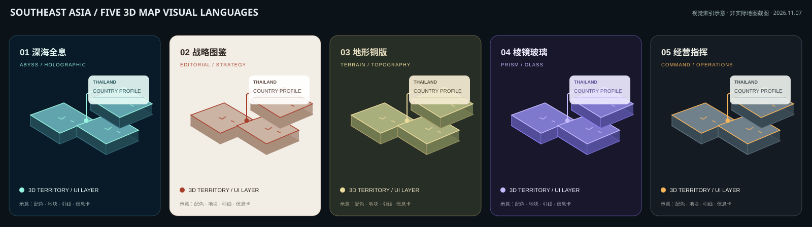
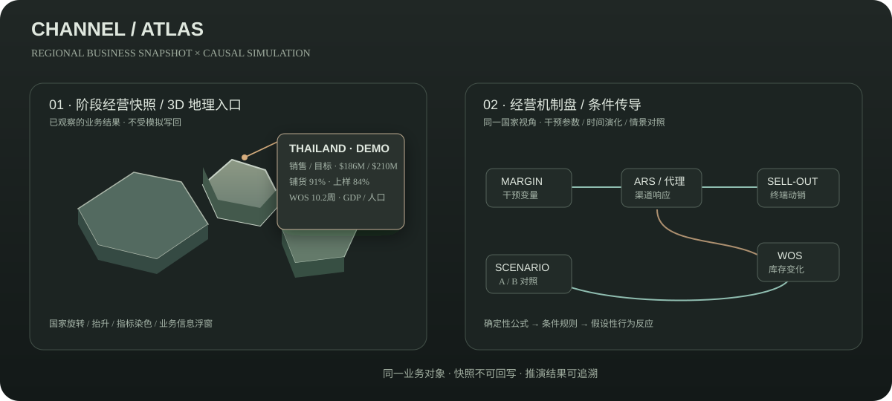
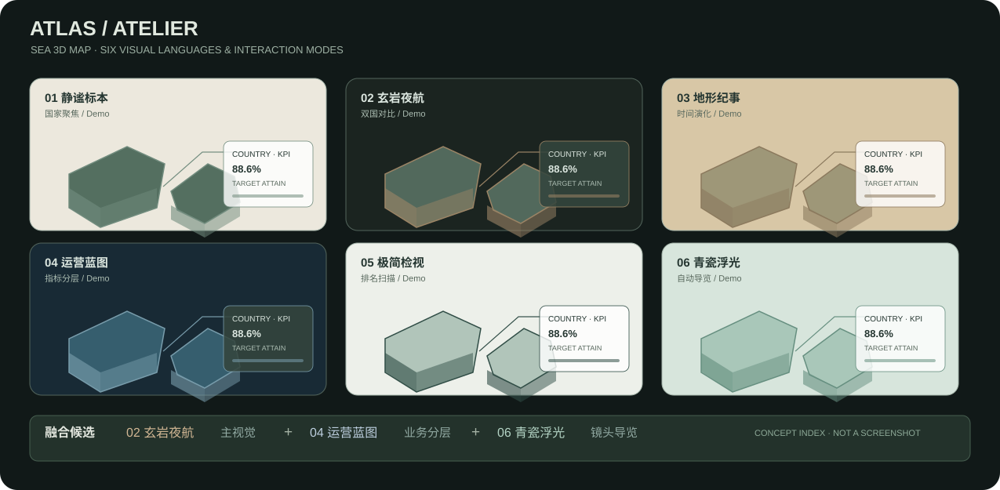

> **Public research extract · 2026-11-22.** All business metrics in referenced demos are illustrative. Links to non-migrated private Obsidian pages are plain text.

---
title: 东南亚真实3D经营地图——交互、空间语义与五种视觉方向
created: 2026-11-07
updated: 2026-11-08
type: synthesis
status: active
narrative: analytical
schema_version: 4
tags:
  - 东南亚
  - 3D地图
  - WebGL
  - HTML看板
  - 渠道经营
  - 交互设计
  - 地理可视化
summary: 记录东南亚地图从2.5D假立体、真实3D挤出沙盘到五套视觉方向的原型实验，归档7个HTML版本及交互画廊，并提出经营指标和渠道网络的钻取规则。
as_of: 2026-11-08
confidence: high
evidence_level: mixed
---

# 🌏 东南亚真实3D经营地图：五种风格与交互实验

> [!abstract]
> **空间可视化是经营地图的索引，不是经营结论本身。** 这次从“平面地图+阴影”的2.5D迭代为**实际含顶面、侧壁、体积和可旋转相机的3D国家地块**。点击任一国家后，该地块立体高亮/轻微升起，由屏幕空间引线连接半透明白色信息卡。研究关注点是如何兼顾吸引力、地图识别、信息可读性和渠道治理钻取。

> [!info] 源与口径
> 2026-11-07 与 ChatGPT 的东南亚地图原型讨论。**Fact**：归档代码的交互行为、页面风格、文件数量；**Opinion**：高管汇报选战略图鉴、常态治理选经营指挥等推荐。地图轮廓经过简化；当前不是DEM真实山川高程；国家基础资料用于演示，**不含公司真实销售、库存、代理商或点位数据**。



> [!important] 2026-11-08 后续 V0.2：地图从地理概况展示进入经营汇报主舞台
> 新版把人口、GDP、销售额/目标/目标达成、铺货与上样完成率、WOS等**阶段快照**叠到国家3D地图；国家选择、指标染色、浮窗后，可切换到业务机制情景盘。原型设计不再是“先做炫酷的地图”，而是**地图作为结论入口，机制推演作为因果探索**。低调指克制配色；炫酷优先体现在互动、视觉过渡和空间反馈。完整HTML与边界见 [综合-东南亚3D经营地图与机制推演双层空间原型](map-simulation-layering.md)。
>
> 

## 一、需求沿革：为什么要求地图本体3D

1. 初版目标：东南亚横向铺开、点击国家、引线从选中国家升起、白底半透明信息卡展示国家概况。
2. 首版采用SVG/2.5D投影：视觉有阴影和厚度，但国家本体不能真实按相机改变可见侧面。
3. 用户明确纠偏：**地图本身要3D**，不是用平面图叠加卡片伪装。
4. 第二版改为真实三维地块挤出，支持拖动旋转、缩放、沙盘/俯瞰/低空视角、国家选中时抬升。
5. 进一步以相同的3D地理模型实验五套设计系统，比较不同演示与治理场景。

### 三种地理表现的边界

| 模式 | 真实结构 | 价值 | 不能声称 |
|:---|:---|:---|:---|
| 2.5D/SVG浮雕 | 平面路径+投影阴影 | 轻量、稳定、静态交付 | 可自由旋转的3D国家实体 |
| **3D挤出沙盘（本次核心）** | 国家多边形含顶面、侧壁、相机透视 | 真立体、视角切换、拾取高亮 | 国家表面已包含真实山川地形 |
| DEM/高程网格地形（下一阶段） | 地形高程采样+地表纹理+国家边界 | 山脉、沿海、岛屿起伏 | 当前原型已经实现 |

> [!info] 后续第二轮实验：六款风格与六种交互语法
> 首轮五套方案及其HTML继续保留；第二轮以相同合成国家经营数据做六个新设计实验（不是给首轮五款简单改名），新增双国对比、时间演化、业务图层展开、排名扫描和镜头巡航等交互。完整单文件sea_3d_six_style_interaction_lab.html已入库；六方案评估与02/04/06融合候选见 [综合-东南亚3D地图六风格评估与融合方案](map-six-style-evaluation.md)。
>
> 

## 二、五套视觉语言对比

| # | 方案 | 视觉语言 | 适用场景 | 容易犯的错 | 原型 |
|:---|:---|:---|:---|:---|:---|
| 01 | 深海全息 / Abyss | 深蓝底、青绿荧光、空间扫描、暗色3D地块 | 科技展厅、开场大屏 | 动效争夺信息注意力 | sea_3d_style_01_abyss.html |
| 02 | 战略图鉴 / Editorial | 米白、朱红强调、克制排版、编辑式地图 | **高管战略汇报** | 无法体现数字证据时变成装饰 | sea_3d_style_02_editorial.html |
| 03 | 地形铜版 / Terrain | 沙金、橄榄绿、纸本地形图语汇 | 区域布局、地理叙事 | 纹理被误解为实际高程 | sea_3d_style_03_terrain.html |
| 04 | 棱镜玻璃 / Prism | 紫蓝渐变、发光边、半透明UI | 产品概念、创新演示 | 玻璃叠层降低对比度 | sea_3d_style_04_prism.html |
| 05 | 经营指挥 / Command | 深灰、琥珀、模块化控制台、事件提示 | **区域经营驾驶舱/渠道治理** | 警示色泛滥造成误报印象 | sea_3d_style_05_command.html |

**选择建议（意见而非测试结论）**：一屏汇报优先02；日常治理优先05；启动仪式/视觉锚点优先01。03、04用于特定品牌表达，不建议仅为炫技而覆盖所有页面。真正比较时应让五套系统使用相同信息密度和同一选中国家状态，避免把“内容差异”误判为“风格差异”。

## 三、空间信息架构：地图与二维卡片各司其职

```text
[真实3D东南亚沙盘]   = 国家空间关系 / 选中聚焦 / 进入详情
     └─ Click 国家 → 实体轻抬升 + 独占高亮
           └─ 世界锚点 world → project(camera) → 屏幕引线
                └─ 白底半透明信息卡（始终正面、清晰、可交互）
                      ├─ Level 1 国家基础事实
                      ├─ Level 2 经营KPI、WOS、覆盖、趋势、异常
                      └─ Level 3 渠道 → 代理商 → 门店/点位 → 事件证据
```

### 必须保持的交互契约

- **一个焦点**：同一时间只有一个主选中国家、一根主要引线、一张主卡。其他国家退到低对比度背景。
- **地图可动、文字不动**：地块受相机旋转影响；文本、指标和卡片停留在HTML屏幕平面，防止斜角阅读困难。
- **正确引线**：引线起点根据选中国家的三维锚点逐帧投影；终点由卡片布局决定，而非写死一个像素坐标。
- **防遮挡**：卡片优先占可用留白，不能压住选中地块；线尽量不穿过主地图；空间紧张时改成右侧固定情报台或底部抽屉。
- **投影与拾取一致**：地图旋转后，点选对象和信息卡引线必须更新；马来西亚、印尼、菲律宾的多岛结构需要独立点击测试。
- **按场景降级**：管理层展示可限制视角与动画；分析工作台允许自由旋转；小屏应优先可读卡片而非追求完整大地图。

## 四、从“视觉场景”到“经营治理地图”

### 两种主要运行模式

**Executive Mode**：默认固定低倾角视角、国家轮廓可辨；首屏拥有结论与少量关键指标；点击后展示国家概要与决策诉求，避免核心内容藏在悬停里。

**Operating Mode**：地图作为区域索引，右侧保留指标与异常处理区；支持市场→渠道→代理商→点位钻取。卡片字段可设计为：业绩/趋势、WOS、门店覆盖、代理关系、包销及风险事件、Owner、最近更新时间、数据来源；这些是**字段候选，不是已接入的真实数据**。

下一代可探索“浮岛国家”模式：选中地块升起并展开本国渠道网络，但应通过层级折叠、连线束合并和二维侧栏细节，避免回到之前流程图“线越画越乱”的困境。参见 [工具-ProcessIR流程图编译与连线验收](../engineering/process-ir-layout-routing.md) 与 概念-2.5D业务治理空间地图。

## 五、实现现状与质量验收

- **运行形态**：浏览器原生HTML/CSS/JavaScript，使用 WebGL 绘制3D网格（有软件渲染退路）；不依赖在线地图底图才能看到地块。国家面被真实挤出，支持旋转、缩放、拾取和抬升动画。
- **地理准确性边界**：简化轮廓及投影构成概念原型，未完成专业GIS精度验证；选中地块高度为设计效果，不代表GDP/营收/权力大小。
- **地形边界**：Terrain为视觉风格名，不表示已加载真实DEM高程。
- **信息边界**：基础国家信息为演示；未经授权不能将真实经营或公司敏感数据放入公开网页。
- **验收清单**：11国可达（包括小国）、点击/旋转/缩放/视角切换无错位、线和卡片不遮挡关键国家、移动端信息可读、WebGL失败时有退路、状态变化显著但不眩目、离线打开并核查数据来源。
- **待做**：采用经授权的标准GeoJSON/TopoJSON校准国界；需要真实地形时再选DEM；接入指标前先固定口径/粒度/刷新时间；加入键盘访问和静态PNG回退。

## 六、文件索引（已入库的原型）

**入口：** [sea_3d_design_gallery.html](../../examples/geospatial/sea_3d_design_gallery.html) — 五套风格切换与实时3D交互预览。为保持归档独立运行，入库版画廊缩略图使用对应HTML的实时预览，而不是原对话PNG缩略图。

| 资产 | 用途 |
|:---|:---|
| sea_3d_interactive_map.html | 初始2.5D/SVG概念基线 |
| sea_true_3d_map.html | 第一套真实3D沙盘基线 |
| sea_3d_style_01_abyss.html | 深海全息3D |
| sea_3d_style_02_editorial.html | 战略图鉴3D |
| sea_3d_style_03_terrain.html | 地形铜版3D |
| sea_3d_style_04_prism.html | 棱镜玻璃3D |
| sea_3d_style_05_command.html | 经营指挥3D |
| [sea_3d_design_gallery.html](../../examples/geospatial/sea_3d_design_gallery.html) | 五风格画廊与互动入口 |
| [东南亚3D地图-五风格视觉索引.svg](../../assets/diagrams/sea-five-style-overview.svg) | 原创风格索引示意图（**非原型截图**） |

文件目录：`可视化示例/东南亚3D地图/`。HTML 是本次原型的权威可复现视觉资料；静态视觉索引用于 Obsidian 页内预览。

## 相关
- [综合-企业经营看板与流程可视化研究地图](research-map.md)
- [综合-企业经营治理HTML看板设计与决策叙事](enterprise-dashboard-narrative.md)
- [概念-看板风格演进与汇报版式](../foundations/dashboard-layout-evolution.md)
- 概念-2.5D业务治理空间地图
- [工具-企业经营治理HTML看板生成与验收](../engineering/html-dashboard-generation-qa.md)
- [工具-ProcessIR流程图编译与连线验收](../engineering/process-ir-layout-routing.md)

> [!note]- 更新记录
> - 2026-11-07：归档2.5D基线、真实3D沙盘、五套视觉方案、交互画廊与方法论，标注地理和演示数据边界。
