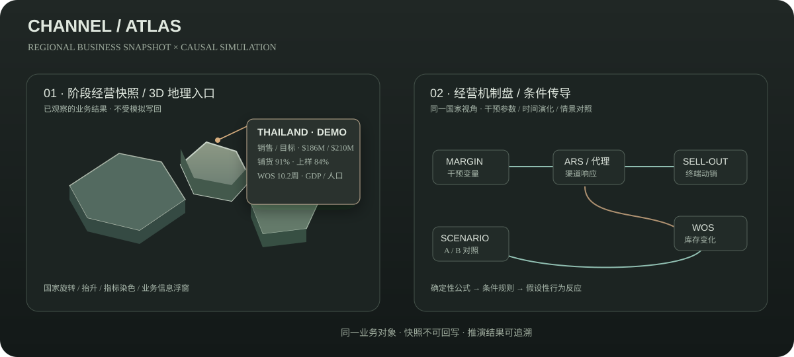
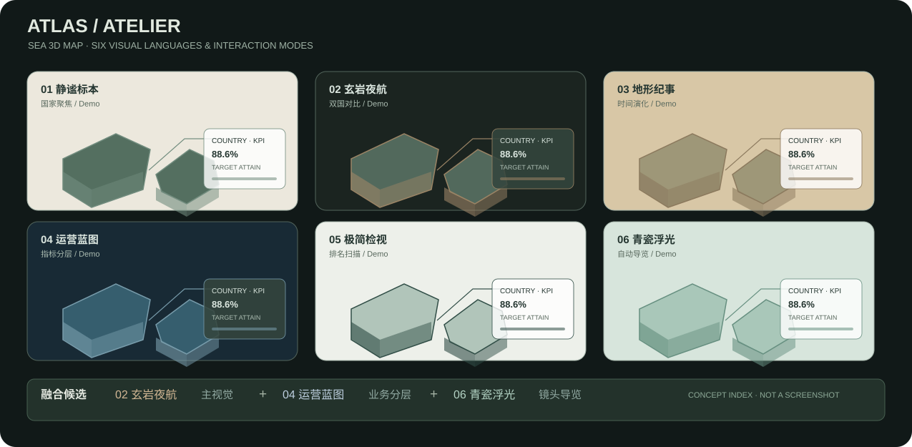

> **Public research extract · 2026-11-22.** All business metrics in referenced demos are illustrative. Links to non-migrated private Obsidian pages are plain text.

---
title: 东南亚3D经营地图与机制推演——双层空间原型
created: 2026-11-08
updated: 2026-11-08
type: synthesis
status: active
narrative: analytical
schema_version: 4
tags: [东南亚, 3D地图, 渠道经营, 经营沙盘, HTML可视化, 情景模拟, Margin, WOS, ARS, 展示设计, DashboardOS]
summary: 归档经营沙盘V0.1关系网络原型与V0.2东南亚3D地图双层空间HTML，形成“阶段静态经营快照→国家钻取→机制干预与推演”的汇报体验；保留低调色系、3D几何交互与原型能力边界。
as_of: 2026-11-08
confidence: high
evidence_level: mixed
review_cycle: event-driven
---

# 🌏 东南亚3D经营地图 × 机制推演：双层空间原型

> [!abstract]
> **地图承担阶段性的经营汇报与国家间直观对比；机制盘承担变量干预、业务关系与连锁传导演示。** 这是2026-11-08经用户反馈从“以关系网络为主屏的V0.1”演进为“3D国家经营地图为主舞台的V0.2”的关键设计：一场汇报既能优雅呈现现有经营成果，又可顺着国家→渠道→政策问题进入推演。**炫酷主要来自交互空间和状态过渡，低调主要来自克制的配色与材质。**

> [!info] 资产与证据边界
> **已入库的交互资产**：sea_3d_business_atlas_v02.html（最新）、channel_atlas_simulation_v01.html（上一阶段基线），原始完整单文件HTML均保存在 `可视化示例/东南亚3D经营机制沙盘/`。下方SVG是本次绘制的**结构索引**，不是浏览器截图。HTML中的人口、GDP、销售、目标、铺货、上样、库存、代理商、产品及其他数字均属于**演示占位/合成业务数据**，不构成可核实的国家宏观统计或企业经营事实；原型未接入公司正式数据源，也没有经过真实经营结果校准。

## 一、这次反馈具体纠正了什么

| 维度 | V0.1 经营关系沙盘 | V0.2 3D地理经营图谱 |
|:---|:---|:---|
| 首屏叙事 | 业务关系网络与干预台居中 | **3D东南亚国家地图居中**，先展示事实快照再进入推演 |
| 汇报对象 | 偏向“解释业务机制如何运行” | 同时满足“汇报阶段成果”与“演示潜在政策连锁反应” |
| 地理呈现 | 以国家选择/左侧切换为主，缺少充分的空间地理表达 | 真实几何挤出感：国家顶面/侧壁、相机角度变化、选择抬升、屏幕引线/浮窗 |
| 经营指标 | 重点显示由推演算出的指标 | 明确加入人口、GDP、销售额、销售目标、目标达成、铺货完成率、终端上样完成率、WOS等**静态阶段快照** |
| 交互表现 | 节点选择、参数控制、路径变化 | 国家拾取、旋转缩放、指标染色、信息卡浮出、地图→机制视图过渡，再接回V0.1推演逻辑 |
| 风格 | 科技感偏强、青绿高亮较多 | **石墨灰、灰绿、暖白、铜金少量强调**；把炫酷放在交互运动而非高饱和色 |
| 数据边界 | 合成推演模型 | **既有经营快照（只读）和假设推演状态（可变）明确隔离**，避免把情景输出误记为经营实绩 |

> [!important] 用户确认的基本定位
> 不退回12页PPT式HTML，也不做仅为自用的日常监控工具。**完整汇报应同时存在两个层次**：第一层用有记忆点的3D地图呈现阶段性成果及国家差异；第二层通过交互展现经营系统中的前因后果、政策改变与情景分歧。该方向继承 [综合-渠道经营机制沙盘与跨模块推演设计](channel-business-mechanism-workbench.md) 的 P0→P3验收次序。

## 二、区域经营地图层（Presentation / Observed Snapshot）

### 数据在地图中的角色

| 类别 | 应展示的内容 | 汇报用法与注意事项 |
|:---|:---|:---|
| 国家基本盘 | 人口、GDP、市场规模背景 | 背景上下文，不与公司销售额混为一谈；真实使用前需核准年份、货币与数据来源 |
| 经营结果 | 销售额、增长率、实际值/目标值、目标达成率 | 指标为阶段快照；明确时间、实际/预算口径、汇率和计量单位 |
| 渠道建设 | 铺货达成、上样达成、门店/网点覆盖 | 必须定义分母（目标点位、应上样网点、样机SKU），显示绝对数与百分比可互核 |
| 渠道健康 | 库存WOS及对应国家/产品/渠道穿透 | 不同渠道、SKU适用阈值不同；跨国聚合不可简单平均周数 |
| 国家结构 | 线下分销/线上分销/KA、产品与代理 | 不应重复计算分销链路与ARS门店的零售售出；国家为切入端而不是唯一归因对象 |

### V0.2已具备的可视化交互
- Canvas投影渲染的3D地块几何：有独立顶面与侧壁、可旋转俯角/缩放、国家选中和抬升，**不是DEM真实地形，也不等于WebGL地形引擎**。
- 点击/切换国家后，相应地图焦点与信息浮窗更新；国家卡片含经营快照、目标/完成状态和从地图进入机制盘的入口。
- 地图可切换目标达成、销售规模、铺货上样、库存WOS等指标着色；切换的是**指标阅读维度**，不修改源快照。
- 侧部经营、产品、Margin、ARS、代理、货盘、综合等观察层与国家对象共享焦点；它们显示的是不同证据视图，而不是七张独立报告页。
- V0.2实际上仍使用 **“地图视图/机制视图”双空间模式切换**，不是从3D地图内部无缝展开全部业务子图的完整空间图谱。此处诚实保留为未来迭代项。

### 可作为原型口径演示的合成数字
例如HTML内的**泰国虚构样本**：Sales 186（演示货币单位M），Target 210，铺货91%，上样84%，WOS 10.2周。它只用于检查卡片、比率、颜色及布局，不得传播为真实销售/完成率。

## 三、机制推演层（Business Dynamics / Assumptions）

地图的经营数据是**观测/冻结快照**；机制盘是基于情景输入而变化的**模型计算结果**。

可演示的路径：
1. 选择国家/产品/渠道的分析上下文；
2. 将零售端 Margin 调整（例如+3个百分点），选择“总点位固定、链路内重分配”与“扩大总点位”；
3. 观察分销商点位/厂家DP与零售经营贡献如何变化；
4. 在明确假设下调节代理执行与零售需求响应；
5. 推进模拟时间，观察Sell-out与库存WOS如何按库存守恒逻辑变化；
6. 将不同政策情景冻结并比较，追溯变化所依据的公式/假设。

**规则分层**：
- **R0 确定性**：在同一RRP基数定义下，总Margin=代理点位+零售点位，DP=RRP×(1−总Margin)。实际合同税收、返利、补贴等需单独建模。
- **R1 条件模型**：WOS=可售库存/周动销量；入库、终端出库、跨渠道调拨与回款/库存占用应遵守各自正确的时间与会计口径。
- **R2 经验假设**：额外Margin是否促进动销、代理能力是否提高铺货等只能作为可调假设，未获验证时不得宣称已知因果。

> [!warning] 静态快照与动态情景必须隔离
> 绝不允许推演模块直接覆写地图上的实际销售、目标达成、铺货或上样快照。可以在地图上以**叠加预测/模拟图层**展示差值，但需显著标注“SIMULATION / 非实绩”、时间范围和模型版本。若将来载入授权真实数据，应把观察、假设、预测输出三个层次在存储和UI中同时隔离。

## 四、审美重新定位：炫酷在交互，克制在配色

### 视觉系统
- **底色/材质**：石墨、深岩色、暗灰绿；局部暖白字与铜金焦点，不使用通屏高亮荧光。
- **空间手段**：真实国家地块立体感、抬升、视角过渡、引线定位、卡片浮出/收起、机制盘层次切换。
- **状态语义**：颜色优先表达“选择/变化/风险/数据层”，不能为了好看把警示色随意应用到所有节点。
- **图表读数**：金额、比例、WOS等准确数字必须放在稳定的2D信息平面中；允许3D作为索引，但不让透视角度降低可读性。
- **互动演示**：30秒能建立国家布局；1次聚焦能看到经营快照；再经过一次显式干预展现链式变化；必要时展开公式/证据。

### 后续视觉实验命题
- 能否实现选中地块的“镜头聚焦→地块浮升→浮窗定位→关联业务结构显形”的单次连贯转场？
- 能否对国家之间的真实经营差异使用统一色尺，而不是按国随机设定视觉强弱？
- 大屏展示距离、不同分辨率下，引线不应遮挡国家或重要数字。
- 是否用更精密的空间镜头和缓动替代不断闪烁的粒子/灯带？

> [!info] 六风格地图实验与融合候选（2026-11-08）
> 在V0.2的**3D经营地图层**上新增独立实验室：sea_3d_six_style_interaction_lab.html，可切换六种3D国家材质、色彩与操作方式；设计对比及“02玄岩夜航×04运营蓝图×06青瓷浮光”融合建议见 [综合-东南亚3D地图六风格评估与融合方案](map-six-style-evaluation.md)。**六风格HTML是独立地图实验，不是已经完成的V0.3经营推演引擎**；V0.2仍为当前已归档的双空间主原型。
>
> 

> [!info] 新的地图渲染层实验（2026-11-08）
> 基于用户对地图本体设计的进一步纠偏，新建 [综合-东南亚3D地图本体六种渲染语言实验](map-rendering-languages.md) 与独立HTML sea_3d_six_map_material_renderings.html，固定页面/经营快照，以卫星质感、地形晕渲、杂志纸质、低多边形、玻璃透明层、工程线框六种地图几何/材质绘制进行比较。**该HTML是地图渲染试验，不是已融合推演主系统的V0.3。**
>
## 五、版本资产与验证

| 文件 | 版本角色 | 状态 |
|:---|:---|:---|
| channel_atlas_simulation_v01.html | V0.1 以业务关系网络为核心的机制沙盘 | 原型资产，合成数据 |
| sea_3d_business_atlas_v02.html | **V0.2 3D经营地图 × 机制推演双层空间** | **当前主原型，完整单文件HTML** |
| [经营地图与机制推演-双层空间语法.svg](../../assets/diagrams/map-simulation-layers.svg) | 经营快照/机制推演视觉架构索引 | **原创结构示意图，不是原型截图** |

**已实现（原型范围）**：国家3D几何选择/旋转/缩放与指标染色、经营阶段快照、七类业务入口、机制空间切换、合成规则下的情景控制和部分跨模块指标更新。

**尚未实现或未证实**：接入真实企业数据、宏观指标权威数据溯源、所有七模块同等粒度的完整推演、真实代理画像/考核驱动的估计、经营行为因果验证、真实DEM地形、WebGL引擎、生产级模型版本化与角色权限、完整的“地图→子图→再子图”无缝三维展开。

**验收先后仍按用户最终规定**：P0业务逻辑与关联数据闭合 → P1交互正确 → P2复杂推演可解释 → P3审美品质。审美方案可从P0同时设计，但不能用视觉效果遮盖模型缺口。

## 六、后续演进路线（设想，不代表正式开发立项）

1. **Snapshot Schema**：按国家×期间×渠道×产品×渠道主体固化统计口径、目标版本、元数据、去重与时效。
2. **Link Model**：Country→Distributor→Retailer/ARS→Product→Inventory，三种关系分别表达交易/授权/归属，避免笼统的“任意两个点连线”。
3. **Model + Compare**：推演规则与静态事实分离；对照情景投影到地图要带有“虚构/预测”标签。
4. **Spatial Narrative**：实现国家地图入口到业务网络再到子盘的连续转场，提升交互空间完整性。
5. **Presentation QA**：面向投屏查看文字、引线、动效、焦点回归与离线可运行性，形成可重复的交付测试。

## 七、相关研究与长期方向

- [综合-渠道经营机制沙盘与跨模块推演设计](channel-business-mechanism-workbench.md)：业务对象与P0–P3门槛，解释**沙盘为什么不是PPT**。
- [综合-东南亚3D经营地图交互与五风格实验](map-five-style-interactions.md)：真正3D挤出、空间引线和五种美术风格的早期研究。
- [综合-企业经营看板与流程可视化研究地图](research-map.md)：整个可视化设计体系的主导航。
- 概念-Weft因陀罗网递归图与证据语义：未来同一事实网络的多视角投影、递归子图和因果假设边界；**不等于Weft已经实现本HTML原型**。

> [!note]- 更新记录
> - 2026-11-08：归档V0.1与V0.2完整HTML、原创双层空间SVG索引和本专题；记录用户对3D国家阶段结果、经营KPI、双空间分工及克制配色的新反馈。
