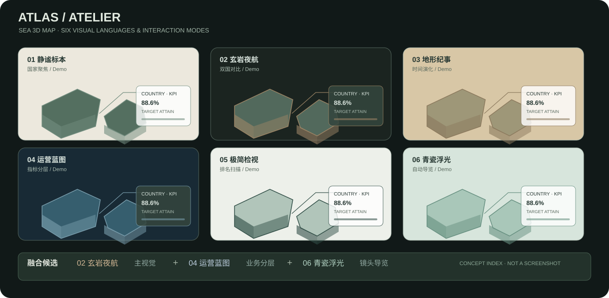

> **Public research extract · 2026-11-22.** All business metrics in referenced demos are illustrative. Links to non-migrated private Obsidian pages are plain text.

---
title: 东南亚3D经营地图——六风格实验与融合设计方案
created: 2026-11-08
updated: 2026-11-08
type: synthesis
status: active
narrative: analytical
schema_version: 4
tags: [东南亚, 3D地图, 经营汇报, 可视化, 交互设计, 画风, 视觉系统, HTML, 经营沙盘, 设计实验]
summary: 归档六套可运行的东南亚3D经营地图风格与交互实验，对比画风/色彩/交互机制并提出02玄岩夜航主视觉、04运营蓝图业务分层、06青瓷浮光镜头导览的融合候选；完整HTML入库，融合版尚未实现。
as_of: 2026-11-08
confidence: high
evidence_level: mixed
review_cycle: event-driven
---

# 🌏 东南亚3D经营地图：六种设计语言与融合方案

> [!abstract]
> **炫酷在交互，低调在配色；3D地图负责展示阶段经营事实，机制盘负责演示条件性变化。** 本轮以同一组**合成国家经营数据**在一个单文件HTML中试验六套画风与不同交互机制。建议下一版采用 **02玄岩夜航的深色材质与经营信息体系 + 04运营蓝图的结构性图层拆解 + 06青瓷浮光的镜头导览**；01、03、05作为可选表达模块保留。**这是融合设计候选，并非已完成的融合HTML或已确认的生产视觉规范。**

> [!info] 已入库资产与真实性边界
> - **完整可交互HTML**：sea_3d_six_style_interaction_lab.html，存放于 `知识库/综合/可视化示例/东南亚3D经营机制沙盘/`（遵循Schema 4.1.1：可执行HTML不放附件目录）。
> - **原创SVG视觉索引**：
> - SVG是对六种设计方向绘制的**概念图**，**不是浏览器截图**。会话中的实际浏览器截图/六图PNG拼图未作为本次仓库资产提交。
> - HTML及截图的销售额、目标、铺货、上样、人口、GDP、WOS、年度变化全部是合成演示内容；无真实公司数据连接或已验证的宏观统计来源。地图为可旋转的国家地块3D几何挤出，不是DEM地形高程。

> [!important] 后续纠偏：地图本体风格 ≠ 整套界面换色
> 用户在2026-11-08明确要求将“style”收敛到**地图的线条、透明度、卫星/地形贴图、卡通/写实/杂志材质与地图级交互动画**，而非变化页面背景、侧栏和卡片。已为此另建一套完全固定外部UI、拥有六种本体绘制算法的原型及专题：[综合-东南亚3D地图本体六种渲染语言实验](map-rendering-languages.md)。原文的02/04/06融合提案仍保留作汇报设计方向，但不要将本页的旧六风格实验误认为已经满足地图材质差异要求。
>
## 一、为什么做这六套实验

在 [综合-东南亚3D经营地图与机制推演双层空间原型](map-simulation-layering.md) V0.2 中，3D地图开始承担**汇报阶段成果**的角色：国家基本盘（人口/GDP）、经营结果（销售额/目标/达成率）、渠道覆盖（铺货/上样）、库存健康（WOS）；进入机制盘后才处理Margin、ARS成本、代理行为和库存流转的条件推演。用户进一步要求不仅要业务逻辑准确，还要在**地图材质、配色、镜头与交互方式**做多套明显不同的设计。

本轮实验原则：**相同国家轮廓、相同合成业务数据，不同视觉变量和交互语法**；不把「换配色」等同于「换交互方案」。

## 二、六套方案：价值、边界和保留角色

| 方案 | 视觉语言 | 核心交互 | 最擅长表达 | 推荐角色 |
|:---|:---|:---|:---|:---|
| **01 静谧标本 / Specimen** | 象牙白、石灰、灰绿，展陈质感 | 地块轻抬升、选中后镜头聚焦 | 国别概况与高端正式感 | 浅色备选主题 |
| **02 玄岩夜航 / Basalt** | 玄武岩深绿黑、哑光铜、暖白 | 双国高亮与经营指标并排比较 | 正式汇报、沉稳空间感与差距表达 | **主视觉基底** |
| **03 地形纪事 / Archive** | 沙金、橄榄、地图铜版 | 模拟年度滑块、地块颜色按年份变化 | 历年增长、产品生命周期与市场演化 | 时间维度插件 |
| **04 运营蓝图 / Blueprint** | 低饱和海军蓝、精密网格、冷灰线条 | 铺货/上样/WOS三层展开与切换 | 将地理空间转成可理解的业务结构 | **业务分层机制** |
| **05 极简检视 / Swiss** | 冷白、灰黑、清晰数字 | 国家扫描定位、指标排序 | 横向比较与数值可读性 | 表格/排名解析视图 |
| **06 青瓷浮光 / Celadon** | 雾青、柔和半透明、微光 | 自动镜头巡航、国别顺序聚焦 | 演示开场、重点国家串联 | **镜头与转场语法** |

> [!tip] 推荐取舍
> **保留六款作为交互实验库，融合设计以02 + 04 + 06为首选。** 其余三款适合作为特定情境下的局部交互或显示模式，不建议做成一套正式汇报中反复切换的六种主题。正式汇报要形成一致的空间品牌体验。

## 三、融合候选——Basalt × Blueprint × Celadon

### 3.1 一套主视觉，而不是三套主题拼贴
- 背景：石墨黑/玄武岩（参考 `#111918`、`#1b2420`）；地图地块为低饱和森林灰绿；文字用暖白；关键焦点用少量哑光铜（如`#bca07b`）。
- 图层边线：04的冷灰蓝仅用于**业务结构层、尺度标注、投影辅助**，不能与主色竞争。
- 动效：06的缓动和镜头语言可以引入，但**不保留青瓷主题的大面积亮绿与玻璃底色**。
- 业务状态的颜色必须有一致语义：`选中焦点`、`正负差异`、`告警风险`、`模拟/实际`不可全部使用同一强调色；不同指标染色保持统一图例和单位，WOS不按“越大越好”着色。

### 3.2 交互按一场汇报的节奏组织

```text
REGIONAL OVERVIEW  — 3D东南亚与阶段静态经营结果
    │ 轻量镜头导览 / 操作者接管
    ▼
COUNTRY FOCUS      — 点击国家，地块抬升 + 引线 + KPI浮窗
    │ 选择横向比较 / 特定指标
    ├── COUNTRY COMPARE  — 双国固定基准、同口径指标同步比较
    └── LAYER EXPLODE   — 上样 / 铺货 / 库存WOS三层结构化展开
            │ 从观察结果中点选值得解释的业务关系
            ▼
MECHANISM / WHAT-IF — 进入推演；固定原始快照，修改情景变量
            │ 时间演化 / 条件响应 / 多情景对照
            ▼
BACK TO ATLAS      — 把模拟变化叠为独立图层，与真实快照区分
```

这里的「导演式」导览只负责**选择与呈现**，不改变业务数据；只有显式的Scenario Action才能改写模拟情景状态。

### 3.3 UI版式与镜头建议（设计提案）
- 地图作为主空间：横向大屏约2/3至3/4的视觉权重，避免永久覆盖大量信息卡；国家聚焦时一张主浮窗 + 小型次级比较窗。
- 工具栏随状态变化：区域全景只出现指标切换/镜头导航；进入国家后显示比较与分层；进入推演后显示变量和时间控制。拒绝一屏同时暴露全部按钮。
- 地图移动，指标卡不歪斜：国家3D实体随相机旋转，引线依据三维锚点投影，数字信息始终在2D稳定屏幕平面。
- 双国比较时锁定时间窗、货币/换算口径与指标定义；面积/国家视觉大小不得暗示销售规模，除非显式切换为规模编码并标注。
- 多图层应在不同高度/深度承载不同**指标集合**，不能通过单个地块高低同时表达WOS与销售，造成语义混淆。
- 自动导览必须可暂停、跳过、被手动操作打断并恢复；禁用不必要的循环闪烁。

## 四、需要与业务模型严格对齐的地方

| 边界 | 设计/模型约束 |
|:---|:---|
| 地图经营结果 | 销售额、目标、铺货/上样为**阶段性观测快照**，不能被拖动模拟参数直接改写 |
| 货盘 WOS | 分产品、国家和渠道按同一期间/口径计算，未知或分母为零时展示不可比，不自动误判健康 |
| 双国比较 | GDP、人口、销售、覆盖数据应列明年份、币种、分母；示例数据不可当真实基准 |
| 经营机制 | Margin、代理投入、ARS经营利润、Sell-out、库存变化的逻辑分层：确定公式/条件运算/行为假设 |
| 3D图层 | 视觉层次需对应明确业务概念，图形可点击路径须可追溯 |
| 模拟层 | 场景A/B结果可展示到地图，但必须标识「SIMULATION / 假设情景」且不覆写事实层 |

## 五、迭代验收与尚未实现事项

仍沿用用户确定的 **P0业务模型/跨模块数据一致 → P1交互正确 → P2推演可解释 → P3审美高水平**，但视觉设计从第一阶段并行参与信息架构。

**本轮已完成/已验证的范围**（六款设计实验HTML，不是融合成品）：
- 6套风格与相应交互模式切换；同一国家几何、同一批合成数据；
- Canvas三维挤出地块的选国、旋转、缩放与指标着色；
- 双国比较、年度示例、指标层叠、排名扫描、自动导览等单项实验；
- 浏览器原型检查包含六风格渲染、年度滑块、展开层、导览、键盘切换及移动端基础可用性。

**尚未完成**：三类设计语法真正整合为一套正式融合HTML；同一个交互过程中平滑从地图层进入经营机制盘并维护完整共享状态；多国真实经营数据/业务对象关系接入；国家→代理→门店深层子图；真实行为响应参数校准与模拟验证；正式投屏环境性能检查。

### 下一阶段优先落实（不是本次已交付）
1. **Visual Prototype**：从六款中抽取02材质、04结构展开、06镜头轨迹，合成单一视觉系统；保留01浅色主题选项。
2. **Semantic Interaction**：将`CountrySelect`、`MetricLayer`、`CameraState`、`ScenarioId`区分为独立状态，避免数据混淆。
3. **Mechanism Handoff**：地图国家/产品/渠道上下文无损传给V0.2机制盘；在返回地图时显示模拟对照图层，不改观测快照。
4. **Evidence + QA**：检查币种/单位/目标分母/时间一致性、地图拾取与指标卡对齐、移动端/投影遮挡、交互状态撤销与复现。

## 六、与Nebula现有研究相互连接

- [综合-东南亚3D经营地图与机制推演双层空间原型](map-simulation-layering.md)：V0.1→V0.2主路线，本轮六风格实验是**其地图视觉/交互层的独立研究**，不是主模拟逻辑的新版本。
- [综合-东南亚3D经营地图交互与五风格实验](map-five-style-interactions.md)：原有地图真实挤出、五套风格的第一轮实验；本页是第二轮六风格及交互语法扩展。
- [综合-渠道经营机制沙盘与跨模块推演设计](channel-business-mechanism-workbench.md)：经营语义、规则分层与P0–P3门槛。
- [综合-企业经营看板与流程可视化研究地图](research-map.md)：看板与流程综合入口。
- 概念-Weft因陀罗网递归图与证据语义：可作为未来子图及多视角语义借鉴，**不是声称Weft已有这套原型的引擎**。

> [!note]- 更新记录
> - 2026-11-08：归档六套可运行的HTML交互风格实验，并给出02/04/06三语法融合候选。浏览器实测截图仍保留在当前会话，不虚构其已入GitHub；另创作SVG结构索引供Obsidian预览。
