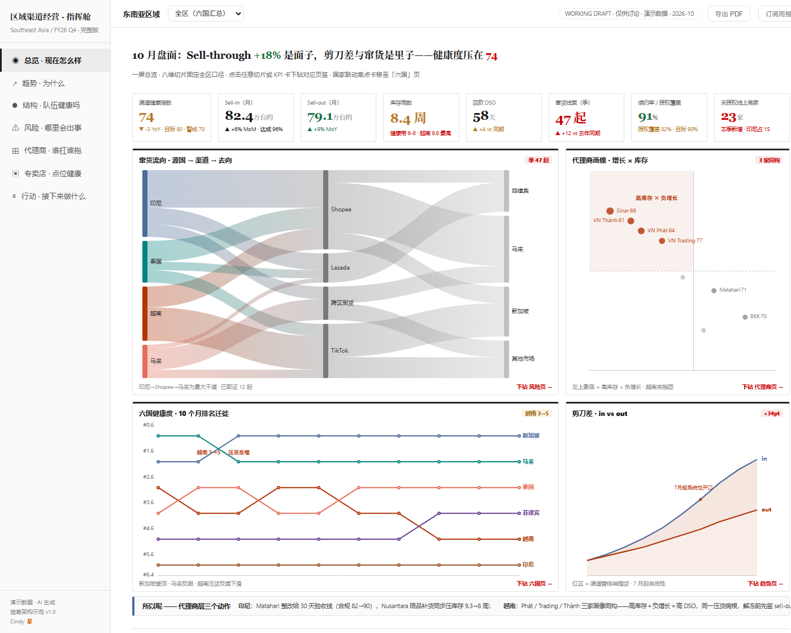
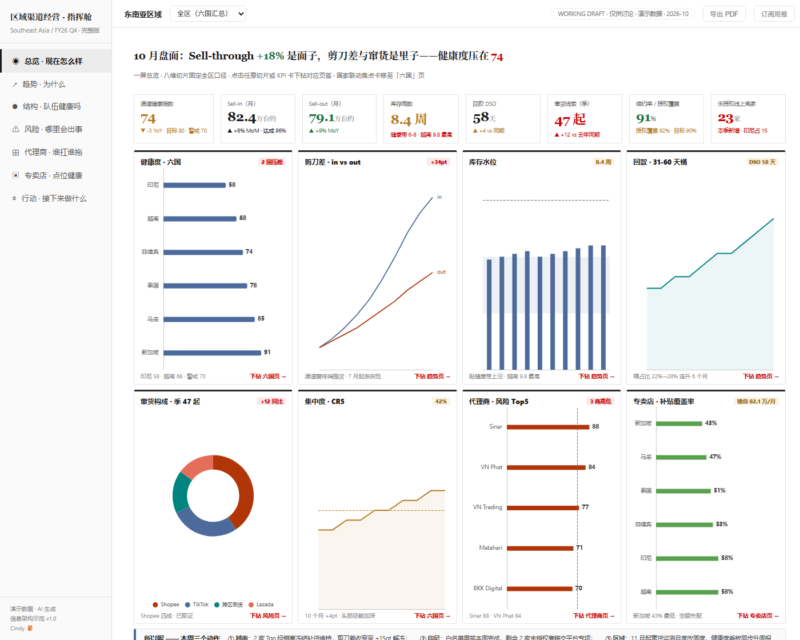
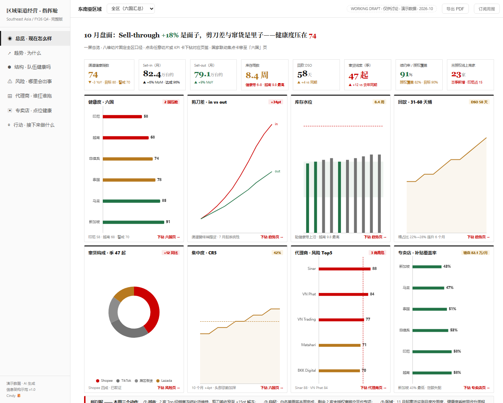
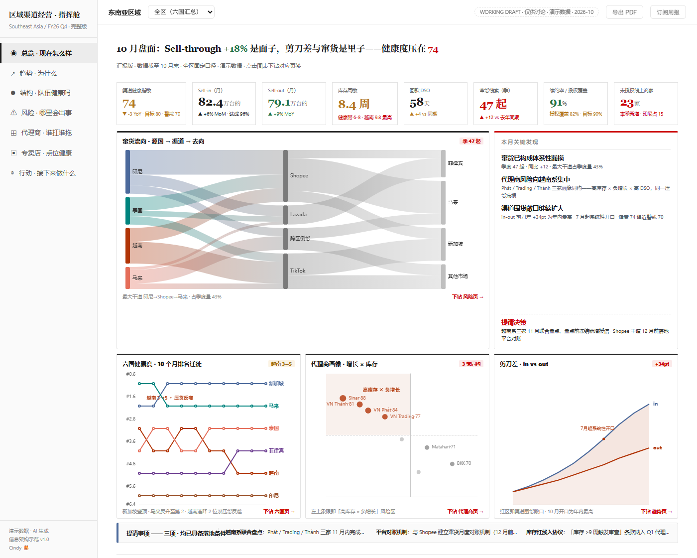
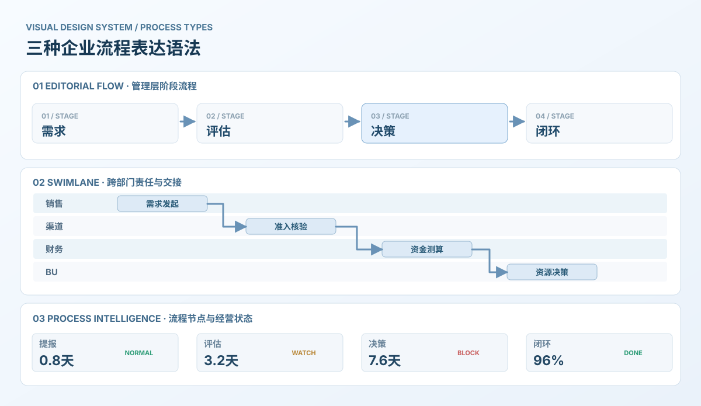
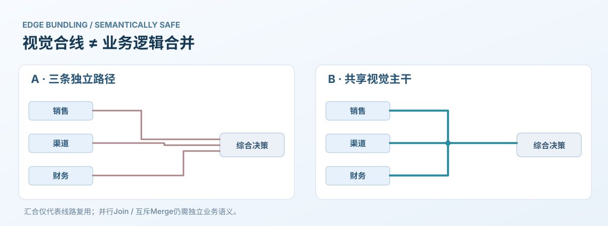
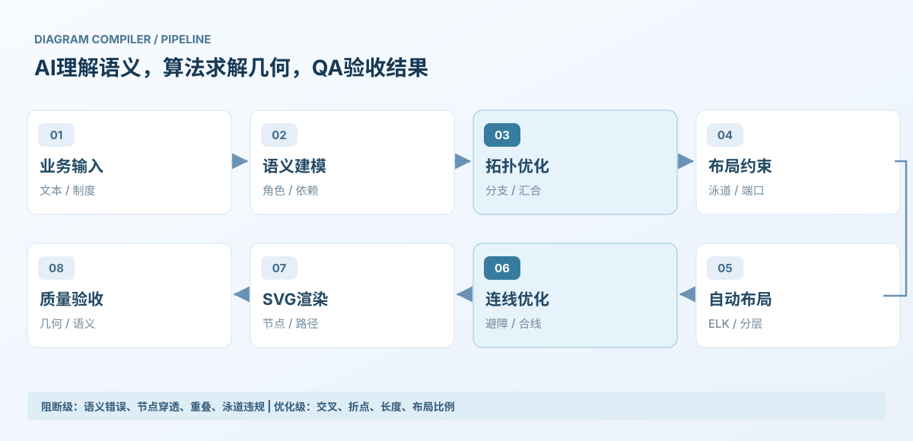
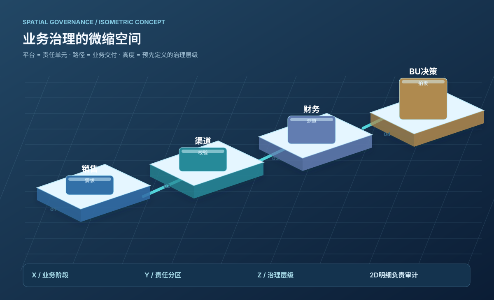
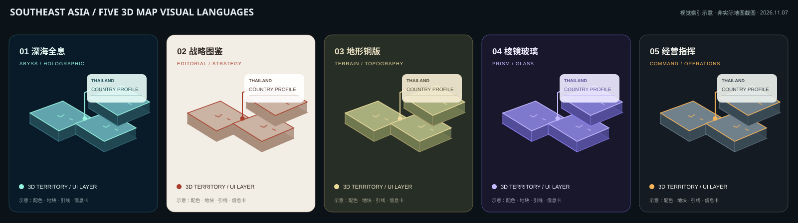
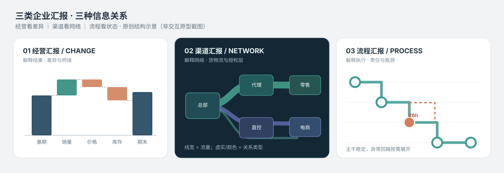

> **Public research extract · 2026-11-22.** All business metrics in referenced demos are illustrative. Links to non-migrated private Obsidian pages are plain text.

---
title: 企业经营看板与流程可视化研究地图
created: 2026-11-07
updated: 2026-11-22
type: synthesis
status: active
narrative: analytical
schema_version: 4
tags:
  - 企业治理
  - HTML看板
  - 流程图
  - 泳道图
  - 2.5D
  - 3D地图
  - 数据叙事
  - 可视化
summary: 经营治理HTML看板、流程图、2.5D/3D地图及五维可视化设计语法的统一研究入口，关联原型、视觉素材与生成验收方法。
as_of: 2026-11-08
confidence: medium
evidence_level: mixed
---

# 🗺️ 企业经营看板与流程可视化研究地图

> [!abstract]
> **从“让图好看”转向“让业务被理解、让责任被看见、让决策有证据”。** 看板优势来自信息设计与论证；流程图瓶颈在语义拓扑、自动布局和连线；2.5D可以提升全景理解与视觉记忆，但复杂条件判断仍需要二维详图。本页是汇总导航，既有研究无需重复复制。

> [!info] 来源
> 讨论日期：2026-10-30～2026-11-07。涉及咨询/财经媒体/科研视觉、区域经营看板排版、HTML示例、流程图与泳道图、ELK与Bus Routing、3D/2.5D等轴测。图像按“既有真实资产”和“新绘制概念示意”分别说明；不混用真实公司经营数据。

## 一、核心研究与实践入口

| 关注点 | 文档 | 产出 |
|:---|:---|:---|
| **ATLAS东南亚经营展示V1（2026-11-18）** | [综合-ATLAS东南亚经营图谱交互原型](atlas-sea-dashboard-case.md) | 可运行单HTML：地图主视觉、国家钻取、经营诊断与简化WOS推演；全部合成数据 |
| **全领域图表库广度审计（2026-11-22）** | [综合-全领域可视化图表库覆盖审计与分类体系](full-spectrum-breadth-audit.md) | V0.1共24分类/630名称，仅185条来源直接列名；七类明确遗漏与广度验收未通过，建立开放式专业图形语言与验证门槛 |
| **五维设计语言与布局语法（2026-11-18新增）** | [概念-可视化看板五维设计语言与布局语法](../foundations/five-dimension-design-grammar.md) | Color / Layout / Material / Chart / Interaction；五类布局语法、数据关系映射、视觉验证研究路线 |
| 避免AI Slop | [概念-AI数据看板设计美学-反AI-Slop](../foundations/anti-ai-slop.md) | 反同质化原则 |
| 企业看板形态与决策叙事 | [综合-企业经营治理HTML看板设计与决策叙事](enterprise-dashboard-narrative.md) | 四类看板、六段叙事与指标/图型词典 |
| 三轮版式迭代和图片 | [概念-看板风格演进与汇报版式](../foundations/dashboard-layout-evolution.md) | P1、B、C、A四版样张 |
| 如何选择流程图表达 | [概念-流程图泳道图的视觉表达与复杂性边界](../foundations/flowchart-swimlane-grammar.md) | 六类流程表达语言 |
| 如何解决凌乱线条 | [工具-ProcessIR流程图编译与连线验收](../engineering/process-ir-layout-routing.md) | ProcessIR、ELK、Router、SVG、QA |
| 3D流程图可能性 | 概念-2.5D业务治理空间地图 | 三种空间化策略及限制 |
| **跨模块经营机制沙盘：最新设计定位** | [综合-渠道经营机制沙盘与跨模块推演设计](channel-business-mechanism-workbench.md) | 七模块关系网络、P0–P3优先级、Margin→ARS→Sell-out→WOS推演、同一画布持续交互 |
| **三类业务汇报看板与交互原型** | [综合-业务经营渠道结构与流程治理三类可视化范式](business-channel-process-visual-paradigms.md) | 经营差异/渠道网络/流程治理三套视觉语法、完整HTML、SVG视觉索引 |
| **地图本体六种渲染语言（最新）** | [综合-东南亚3D地图本体六种渲染语言实验](map-rendering-languages.md) | 卫星质感、地形、杂志、低多边形、玻璃、线框真正不同的国家地块渲染算法及可运行HTML |
| **东南亚3D六风格交互实验与融合方案** | [综合-东南亚3D地图六风格评估与融合方案](map-six-style-evaluation.md) | 六套不同地图画风与交互模式、完整HTML、02/04/06融合设计和原创SVG视觉索引 |\n| **东南亚3D经营地图 × 机制推演V0.2** | [综合-东南亚3D经营地图与机制推演双层空间原型](map-simulation-layering.md) | 地图呈现阶段销售/目标/铺货/上样等经营快照，切到条件模拟；两份完整HTML及SVG视觉索引 |\n| **东南亚真实3D地图（五风格）** | [综合-东南亚3D经营地图交互与五风格实验](map-five-style-interactions.md) | WebGL挤出国家、动态引线、11国交互、5套HTML与画廊 |
| HTML落地 | [工具-企业经营治理HTML看板生成与验收](../engineering/html-dashboard-generation-qa.md) | Prompt、数据契约与验收 |

## 二、讨论的演进：10/30 → 11/07

1. **看板的目标是经营决策，而非风格竞赛**：咨询式逻辑、经济学人式编辑、双十一指挥中心和科研证据规则，需要服务具体读者。
2. **从“好看的图”升级为“好看的论证”**：态势监控与管理层汇报是两类产品。A版采用结论标题→KPI证据行→主图+发现栏→提请事项。
3. **流程图不能直接套用图片审美技巧**：流程图的边表达约束与依赖，图越大，交叉/折点/反向路径越难人工调整；只是给节点加阴影无法消除杂线。
4. **把流程可视化做成编译流水线**：自然语言→流程语义与ProcessIR→拓扑检查→布局约束→ELK→自定义路由和视觉合线→SVG→浏览器QA。
5. **3D需要业务语义才能成立**：2.5D以平台、工作站、空间层次展示系统全貌；2D仍负责规则核验、交接责任和审计。

## 三、图片与示例资产总览

### 已在Nebula保存的四张看板PNG（原资产，复用）

*P1：杂志化的四张高级图。*

*B：OWID叙事纯色板。*

*C：IBCS语义骨架。*

*A：结论优先的管理层汇报版式。*

原有可交互HTML：区域渠道经营治理-三种设计范式演示.html（可视化示例/）。

### 本次新增的原创SVG概念图

*叙事型流程/泳道/监控流程的视觉语法对照。*

*未经整合的独立连线与共享视觉主干。*

*语义→布局→布线→渲染→验收工作流。*

*固定视角的2.5D业务地图原型。*

> [!warning] 图像版权与来源边界
> 此前聊天中出现的某些3D等轴测外部作品由网页图片检索即时显示，当前没有可核验的本地原始文件及转载权限，因此**没有把外部原图伪装成已入库**。本次四张SVG是按讨论内容重新绘制的原创示意图，不是外部图片的复制品；以前的四张PNG已实际存在于附件，无须重复上传。图中的流程、指标均为概念演示，不代表真实企业资料。

### 新增：真实3D东南亚地理沙盘与五风格原型（2026-11-07）

*原创风格示意图；实际地图形态请打开交互HTML，示意图不是原型截图。*

- 专题：[综合-东南亚3D经营地图交互与五风格实验](map-five-style-interactions.md)。
- 交互画廊：[sea_3d_design_gallery.html](../../examples/geospatial/sea_3d_design_gallery.html)；真实3D基线：sea_true_3d_map.html；2.5D基线：sea_3d_interactive_map.html。
- 五风格：sea_3d_style_01_abyss.html / sea_3d_style_02_editorial.html / sea_3d_style_03_terrain.html / sea_3d_style_04_prism.html / sea_3d_style_05_command.html。
- 存放：`可视化示例/东南亚3D地图/`。地块为WebGL挤出，并非DEM真实高程；经营字段是未来接入设想，未使用真实公司数据。

### 新增：业务经营、渠道结构、流程治理三场景（2026-11-07）

- 专题：[综合-业务经营渠道结构与流程治理三类可视化范式](business-channel-process-visual-paradigms.md)（经营桥接、货物流/权责网络、地铁线式流程监控、双层汇报结构与Weft连接）。
- 交互HTML：[enterprise_dashboard_triptych.html](../../examples/dashboards/enterprise_dashboard_triptych.html)，目录 `可视化示例/业务汇报-渠道结构-流程治理/`。可切换场景、国家、渠道关系图层及流程节点。
- 视觉索引SVG是原创结构示意而非浏览器截图；HTML是二维SVG方案，**暂不含3D地图本体**。数据全为合成示例。

## 2026-11-08 最新方向：从汇报页面到经营机制沙盘

> [!important] 产品定位纠偏
> 用户真正想要的是**用于领导展示与跨部门分享的经营推演大屏**，不是把PPT改成HTML，也不是高频盯数的自用Dashboard。七种业务视角须共用状态与规则，一个干预可产生可解释的跨模块连锁反应。优先级：P0业务/数据联动正确 → P1交互正确 → P2复杂推演 → P3审美在线。
>
> 完整的需求沿革、公式口径、情景演示、设计与验证路线见 [综合-渠道经营机制沙盘与跨模块推演设计](channel-business-mechanism-workbench.md)。此前的3D地图与三场景原型是视觉/交互素材，**不能冒充完整经营推演已实现**。

## 2026-11-18 新方向：从视觉风格走向五维设计语法

> [!important] 研究方向更新
> 将「什么风格好看」重新表述成「什么**信息意图**需要什么视觉语言」。五个彼此协同的设计维度是 **Color（配色）/ Layout（排版布局）/ Material（材质）/ Chart（图表）/ Interaction（交互动画）**；上游增加 Information Intent（对象、关系、目标读者与认知任务），下游通过真实截图、业务口径、阅读任务和交互状态验证。完整规则、文献线索及实验设计见 [概念-可视化看板五维设计语言与布局语法](../foundations/five-dimension-design-grammar.md)。

- **Layout 重点突破**：将布局从容器排列提升为「信息关系的空间表达」，建立 Matrix / Editorial / Hierarchical / Flow / Spatial 五种工作原型，研究接近、相似、尺度、方向、嵌套和留白如何引导阅读。
- **Material 有功能角色**：羊皮纸、磨砂纸、玻璃、金属、地形、线框分别作为可测试的视觉隐喻，不等同于换CSS皮肤；高信息密度图表优先可读性。
- **Chart 根据任务选编码**：排名、偏差、趋势、构成、分布、相关、流向与地理关系应选择不同图型，保留比较基准、口径及数据精度。
- **Interaction 根据任务选行为**：焦点、钻取、联动、时间轴、场景推演和证据追溯按信息任务匹配；动画用于保持对象和上下文关系，不能掩盖主要判断。
- **实施与验证**：建立设计规则库、视觉语言库、案例与反例库，并以同一合成数据做多布局A/B任务测试。此时仍为**方法论研究方向**，不是已经交付的自动设计引擎。

## ATLAS V1：五维设计语法的第一个整合演示（2026-11-18）

- 交互HTML：[sea_business_dashboard_atlas_v1.html](../../examples/dashboards/sea_business_dashboard_atlas_v1.html)，存于 `知识库/综合/可视化示例/东南亚3D经营机制沙盘/`。
- 专题说明：[综合-ATLAS东南亚经营图谱交互原型](atlas-sea-dashboard-case.md)，记录设计取舍、操作方法和验证边界。
- 相较此前地图本体六风格实验，本版重点从**国家地理形态与材质**推进到 **Layout + Chart + Interaction** 的单屏叙事组合；不等于完整经营机制沙盘落地。
- 静态HTML内所有数据均为模拟，尚未连接真实业务系统。

## 2026-11-22 全领域可视化图表库广度纠偏

- 研究边界从 FT Visual Vocabulary 所强调的**统计表达任务**扩展为涵盖工程制图（含爆炸图）、建筑、科学、地学、医疗、生物、天文、交通、电气、网络安全与专用业务图解的**全领域视觉表达类型系统**。
- 本轮 JSON 基线为 24 个一级分类、630 个去重名称，其中 185 项仅证明“来源目录直接列名”，445 项待逐条核对；HTML索引和少数演示**不代表630种图型均已实现**。
- 当前覆盖尚缺电气电子、地质、天文、安全、交通、化学、运动分析等专业图型体系，README 旧数字619/184/435与 JSON 630/185/445不一致。
- 后续按**学科领域地图→专业图型词典→语义去重→视觉样例/证据→HTML组件与浏览器验收**推进；不能拿大量名称等价于“全部覆盖”。详细缺口与验证等级见 [综合-全领域可视化图表库覆盖审计与分类体系](full-spectrum-breadth-audit.md)。

## 四、统一信息设计框架

| 层 | 首要问题 | 质量边界 |
|:---|:---|:---|
| 证据/决策层 | 谁需要知道什么、决定什么？ | 指标可追溯，Fact≠Inference |
| 图型选择层 | 表达顺序、责任、数量还是因果？ | 不默认全部画流程图 |
| 图结构层 | 节点/条件/并行/网关正确吗？ | 语义不可被美化改写 |
| 图几何层 | 如何减少交叉、穿透和折点？ | 布局与路由由算法承担 |
| 表现层 | 2D还是2.5D，适合什么读者？ | 不以立体感牺牲准确度 |
| 经营层 | 异常如何转化成行动？ | Owner、SLA、反馈闭环 |

核心排序：**业务正确 > 没有穿透/重叠 > 线路整洁 > 表面美化。**

## 五、下一轮可验证实验

- 一个完全合成的销售→渠道→财务→BU案例，制作二维摘要、二维泳道与等轴测图三版，测试30秒理解速度和错误率。
- V1先做ProcessIR + ELK + SVG + QA；V2固定泳道、回退路由、线束合并；V3叠加经营KPI与治理闭环。
- 将看板方法逐步抽象为Dashboard OS：原则→设计规范→组件→页面模板→视觉/语义评估；目前是研发方向，非既成系统。
- 对公司数据严格遵守授权和信安要求；公开实验只用合成数据。

## 相关
- [综合-企业经营治理HTML看板设计与决策叙事](enterprise-dashboard-narrative.md)
- [概念-看板风格演进与汇报版式](../foundations/dashboard-layout-evolution.md)
- [概念-流程图泳道图的视觉表达与复杂性边界](../foundations/flowchart-swimlane-grammar.md)
- [工具-ProcessIR流程图编译与连线验收](../engineering/process-ir-layout-routing.md)
- 概念-2.5D业务治理空间地图
- [综合-东南亚3D经营地图交互与五风格实验](map-five-style-interactions.md)
- [综合-业务经营渠道结构与流程治理三类可视化范式](business-channel-process-visual-paradigms.md)
- [工具-drawio-workflow](../engineering/drawio-workflow.md)

> [!note]- 更新记录
> - 2026-11-07：主题归档导航建立，引用四张已有PNG及HTML，新增四张原创SVG概念图。
> - 2026-11-07：追加东南亚真实3D地图的五风格HTML、互动画廊、视觉索引及独立研究页。
> - 2026-11-07：新增经营/渠道/流程三场景交互原型和SVG语法索引，联动Weft统一投影方向。
> - 2026-11-08：加入七模块经营机制沙盘方向，纠正PPT式汇报/弱交互与业务推演的边界。
> - 2026-11-18：增加五维视觉设计语法与布局信息关系研究入口、验证路线。
> - 2026-11-18：增加 ATLAS 东南亚经营展示 V1 实际HTML资产及说明页入口。
> - 2026-11-22：新增全领域图型覆盖审计入口，保留630条研究基线的来源分级与不通过结论。
